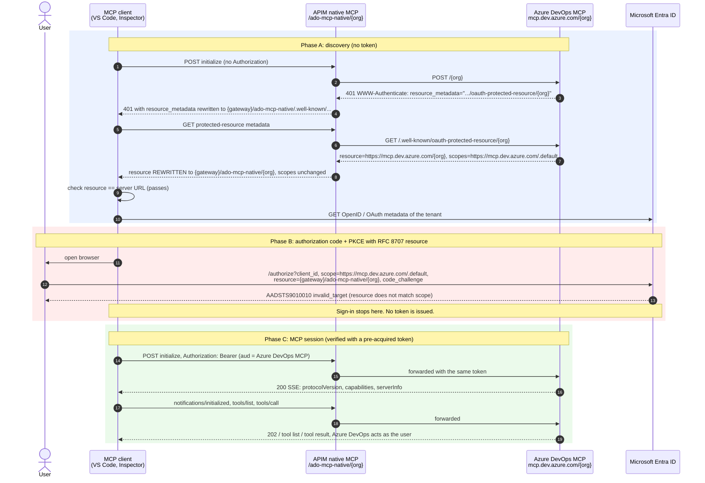
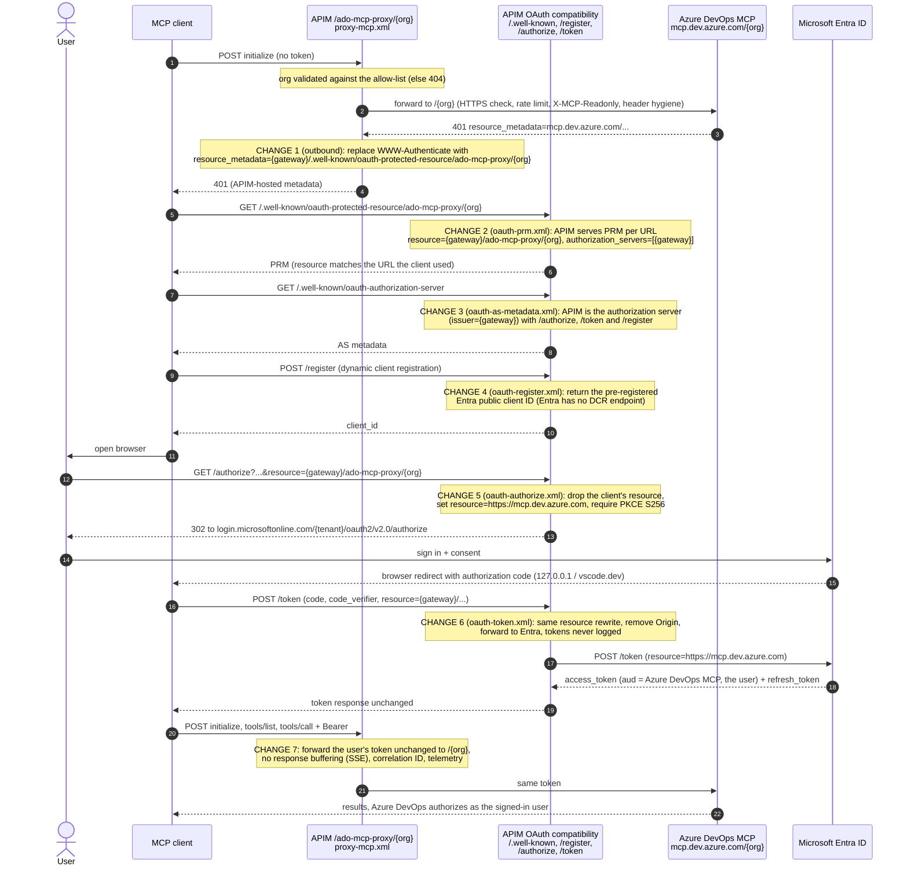

# Azure DevOps MCP server behind Azure API Management

## What this repository solves

**Audience:** platform and security teams who want AI assistants (GitHub Copilot in
VS Code, GitHub Copilot CLI, OpenAI Codex CLI, Claude Code, MCP Inspector and similar MCP
clients) to use the **hosted Azure DevOps MCP server** through their **central API gateway**.

**Why a gateway.** Organizations put Azure API Management (often branded as their *AI
gateway*) in front of every AI tool endpoint. That gives one governed entry point with
rate limits, tool restrictions (read-only, toolsets), header hygiene, IP/network control,
central logging in Application Insights / Log Analytics, and a stable URL they can
allow-list. **APIM's role here is that governance layer. It is not an identity provider
and must not replace the user's identity.** Azure DevOps must keep authorizing and
auditing every call as the signed-in user.

**The problem.** APIM's built-in *MCP pass-through* rewrites the server's OAuth
discovery metadata so that it points at the gateway. Microsoft Entra then refuses to sign
the user in (`AADSTS9010010`). The MCP traffic itself would work, but clients never get a
token. Support confirmed this is by design. The usual workaround, APIM Credential Manager,
replaces the user's identity with a shared one.

**What this repository gives you:**

1. A **reproduction** of the failure (regular setup), with raw responses, telemetry and a
   root-cause analysis.
2. A **working setup** where APIM stays a transparent, governed proxy. It answers OAuth
   discovery itself and translates one parameter (`resource`) on the way to Entra. The
   user's own Azure DevOps token flows through unchanged, for any number of organizations.
3. **Tooling** to prove it: Bicep, an end-to-end probe, KQL queries, and step-by-step tests
   with VS Code, GitHub Copilot CLI, OpenAI Codex CLI, Claude Code, MCP Inspector and curl.

## At a glance

A reproducible lab that puts the **hosted Azure DevOps MCP server**
(`https://mcp.dev.azure.com/<org>`) behind **Azure API Management (APIM)** in two ways,
side by side, with full telemetry:

| | Regular setup | Working setup |
|---|---|---|
| APIM feature | Native MCP pass-through ("expose an existing MCP server") | Plain HTTP API proxy + OAuth compatibility endpoints |
| Client URL | `https://<gateway>/ado-mcp-native/<org>` | `https://<gateway>/ado-mcp-proxy/<org>` |
| `initialize`, `tools/list`, `tools/call` with a valid token | ✅ | ✅ |
| Sign-in from VS Code / MCP Inspector / Claude Code | ❌ `AADSTS9010010` or no DCR | ✅ |
| Sign-in from GitHub Copilot CLI / OpenAI Codex CLI | ⚠️ see [Client compatibility](#client-compatibility) | ✅ |
| Who Azure DevOps sees | The signed-in user | The signed-in user |

The working setup builds on [carolga/ado-apim](https://github.com/carolga/ado-apim)
(see [Credits](#credits)). Both setups send telemetry to Application Insights and Log
Analytics, ship ready-made KQL, and come with an end-to-end probe that tests the origin and
the gateway the same way.

### Documentation: a learning path

| Step | Read | You learn |
|---|---|---|
| 1 | This README | What the problem is, why a gateway, how both setups work (10 minutes) |
| 2 | [Getting started](docs/GETTING-STARTED.md) | Deploy the lab step by step, with expected output |
| 3 | [Testing](docs/TESTING.md) | Probe, raw protocol with curl/PowerShell, logs, validation tests |
| 4 | [Client guides](docs/clients/README.md) | VS Code, GitHub Copilot CLI, OpenAI Codex CLI, Claude Code, MCP Inspector |
| 5 | [What APIM changes for clients](docs/CLIENTS-APIM-CHANGES.md) | Each gateway change: client behaviour, the error without it, before/after, how to verify |
| 6 | [Policies](docs/POLICIES.md) | Every APIM policy, element by element |
| 7 | [Analysis](docs/ANALYSIS.md) | Root cause, reference implementation, options, sources |
| 8 | [Azure AI Gateway](docs/AI-GATEWAY.md) | Does the new AI Gateway (GA 2026-11-17) solve this natively? Requirement matrix and live test |
| — | [Glossary](docs/GLOSSARY.md) · [Observability](docs/OBSERVABILITY.md) · [Tool validation](docs/TOOL-VALIDATION.md) | Reference |

## How a remote MCP server connection works

The hosted Azure DevOps MCP server is a **remote MCP server** using the
[Streamable HTTP transport](https://modelcontextprotocol.io/specification/2025-06-18/basic/transports#streamable-http):

- **One endpoint.** The client sends every JSON-RPC message as an HTTP `POST` to one URL
  (`https://mcp.dev.azure.com/<org>`). The server answers with JSON or, as here, a
  Server-Sent Events (SSE) stream (`Content-Type: text/event-stream`, `event: message` /
  `data: {…}`). A gateway must never buffer or read that stream.
- **Lifecycle.** `initialize` negotiates the protocol version (`2025-06-18`) and
  capabilities. Then the client sends the `notifications/initialized` notification
  (answered with `202`), discovers tools with `tools/list`, and invokes them with
  `tools/call`. Servers may issue an `Mcp-Session-Id`; the Azure DevOps server does not, so
  it is stateless.
- **Authorization**
  ([MCP authorization](https://modelcontextprotocol.io/specification/2025-06-18/basic/authorization)).
  The server is an OAuth 2.1 *protected resource* and Entra is the *authorization server*.
  A client without a token gets `401` plus a `WWW-Authenticate` header pointing to the
  **protected-resource metadata** (PRM, [RFC 9728](https://datatracker.ietf.org/doc/html/rfc9728)).
  The PRM names the resource, its scopes and its authorization servers. The client then:
  1. reads the authorization server's metadata ([RFC 8414](https://datatracker.ietf.org/doc/html/rfc8414));
  2. obtains a client ID (pre-registered, built in, or [dynamic registration](https://datatracker.ietf.org/doc/html/rfc7591));
  3. runs the authorization-code flow with PKCE in a browser, sending the PRM `resource` as
     the [RFC 8707](https://datatracker.ietf.org/doc/html/rfc8707) `resource` parameter
     together with the scopes;
  4. exchanges the code for an access token and sends `Authorization: Bearer <token>` on
     every MCP request.
- **What Azure DevOps expects.** A delegated Entra token for the *Azure DevOps MCP* app
  (`2a72489c-aab2-4b65-b93a-a91edccf33b8`, scope `https://mcp.dev.azure.com/.default` →
  `Ado.Mcp.Tools`). Azure DevOps then calls its REST APIs **as that user**. Entra accepts as
  `resource` only that app's identifier URIs: `https://mcp.dev.azure.com`,
  `https://mcp.dev.azure.com/`, `api://2a72489c-…` and the app ID.

A gateway in the middle must therefore get two things right. **Discovery** must lead the
client to a consistent resource/scope pair that Entra accepts. The **data plane** must
forward the user's token and stream responses untouched.

## The problem

With **native MCP pass-through**, APIM rewrites the origin's `resource_metadata` URL **and**
the PRM `resource` to the gateway URL. This is by design and cannot be changed by policy.
It leaves `scopes_supported` pointing to Azure DevOps. VS Code requires `resource` to equal
the URL it connected to, and has forwarded it to Entra since May 2026
([microsoft/vscode#314784](https://github.com/microsoft/vscode/pull/314784)). Entra then
receives a gateway URL as the resource but an Azure DevOps scope, and rejects the request
before anyone can sign in.

### Raw responses (lab, 2026-11-17; host, organization and tenant replaced by placeholders)

**1. Unauthenticated `initialize`. The origin's challenge, then the one APIM returns:**

```http
POST https://mcp.dev.azure.com/<org>
HTTP/1.1 401 Unauthorized
WWW-Authenticate: Bearer resource_metadata="https://mcp.dev.azure.com/.well-known/oauth-protected-resource/<org>"
Content-Length: 0
```

```http
POST https://<gateway>/ado-mcp-native/<org>
HTTP/1.1 401 Unauthorized
WWW-Authenticate: Bearer resource_metadata="https://<gateway>/ado-mcp-native/.well-known/oauth-protected-resource/<org>"
Content-Length: 0
x-apim-request-id: <request-id>
```

**2. Protected-resource metadata. Origin, then the version rewritten by APIM. `resource` changed, `scopes_supported` did not:**

```json
GET https://mcp.dev.azure.com/.well-known/oauth-protected-resource/<org>
{
  "resource": "https://mcp.dev.azure.com/<org>",
  "authorization_servers": [ "https://login.microsoftonline.com/<tenant-id>/v2.0" ],
  "bearer_methods_supported": [ "header" ],
  "scopes_supported": [ "https://mcp.dev.azure.com/.default" ]
}
```

```json
GET https://<gateway>/ado-mcp-native/.well-known/oauth-protected-resource/<org>
{
  "resource": "https://<gateway>/ado-mcp-native/<org>",
  "authorization_servers": [ "https://login.microsoftonline.com/<tenant-id>/v2.0" ],
  "bearer_methods_supported": [ "header" ],
  "scopes_supported": [ "https://mcp.dev.azure.com/.default" ]
}
```

**3. The authorization request a client builds from that PRM. Entra rejects it immediately:**

```http
GET https://login.microsoftonline.com/<tenant-id>/oauth2/v2.0/authorize?client_id=<public-client-id>
    &response_type=code&redirect_uri=http://127.0.0.1:33418/&code_challenge=…&code_challenge_method=S256&state=demo
    &scope=https://mcp.dev.azure.com/.default
    &resource=https://<gateway>/ado-mcp-native/<org>
HTTP/1.1 302 Found
Location: http://127.0.0.1:33418/?error=invalid_target&error_description=AADSTS9010010: The resource parameter
  provided in the request doesn't match with the requested scopes. Trace ID: <trace-id> Correlation ID: <correlation-id>
  Timestamp: 2026-11-17 18:40:16Z&state=demo
```

**4. The data plane is fine.** With a pre-acquired delegated token, the same native API works and Azure DevOps answers as the user:

```http
POST https://<gateway>/ado-mcp-native/<org>        Authorization: Bearer <token>
HTTP/1.1 200 OK
Content-Type: text/event-stream

event: message
data: {"result":{"protocolVersion":"2025-06-18","capabilities":{"logging":{},"tools":{}},"serverInfo":{"name":"AzureDevOps.Mcp","version":"1.0.0.0"}},"id":1,"jsonrpc":"2.0"}
```

```http
POST https://<gateway>/ado-mcp-native/<org>        {"method":"tools/call","params":{"name":"core_list_projects","arguments":{"top":5}}}
HTTP/1.1 200 OK
Content-Type: text/event-stream

event: message
data: {"result":{"content":[{"type":"text","text":"[{\"id\":\"<project-id>\",\"name\":\"<project>\",\"url\":\"https://dev.azure.com/<org>/_apis/projects/<project-id>\",\"state\":\"WellFormed\",\"visibility\":\"Private\",…}]"}]},"id":3,"jsonrpc":"2.0"}
```

**5. The working setup.** APIM serves PRM and authorization-server metadata, and its
`/authorize` sends Entra a `resource` that matches the scope:

```json
GET https://<gateway>/.well-known/oauth-protected-resource/ado-mcp-proxy/<org>
{
  "resource": "https://<gateway>/ado-mcp-proxy/<org>",
  "authorization_servers": [ "https://<gateway>" ],
  "bearer_methods_supported": [ "header" ],
  "scopes_supported": [ "https://mcp.dev.azure.com/.default" ],
  "resource_name": "Azure DevOps MCP via API Management"
}
```

```http
GET https://<gateway>/authorize?client_id=<public-client-id>&…&resource=https://<gateway>/ado-mcp-proxy/<org>
HTTP/1.1 302 Found
Location: https://login.microsoftonline.com/<tenant-id>/oauth2/v2.0/authorize?client_id=<public-client-id>&response_type=code
  &redirect_uri=http://127.0.0.1:33418/&scope=https://mcp.dev.azure.com/.default&code_challenge=…&code_challenge_method=S256
  &state=demo&resource=https://mcp.dev.azure.com
```

Entra then serves the normal sign-in page, and the user's token works through the proxy
exactly as in step 4. Reproduce all of this with `tools/mcp_probe.py` or the curl/PowerShell
snippets in [docs/TESTING.md](docs/TESTING.md#2-curl--powershell-raw-protocol).

## Diagram 1: how an MCP client connects, and where native pass-through breaks

High-resolution exports: [SVG](docs/diagrams/01-mcp-connect-native-pass-through.svg) · [PNG](docs/diagrams/01-mcp-connect-native-pass-through.png) · [Mermaid source](docs/diagrams/01-mcp-connect-native-pass-through.mmd)



| Step | What happens | Why it matters |
|---|---|---|
| 1–2 | The client opens the MCP session with `initialize`, without a token. APIM forwards it to the origin. | Clients discover authorization only when the server says it is needed. |
| 3 | Azure DevOps answers `401` with `WWW-Authenticate: Bearer resource_metadata=…`. | This is the MCP-standard pointer to the PRM document. |
| 4 | **APIM rewrites** that URL to its own host (native pass-through feature). | The client will now read metadata through APIM. |
| 5–7 | The client fetches the PRM; APIM proxies it from the origin. | The PRM names `resource`, `scopes_supported` and `authorization_servers`. |
| 8 | **APIM rewrites `resource`** to the gateway URL and leaves the scope as Azure DevOps. | The source of the inconsistency. Not configurable. |
| 9 | The client checks that `resource` equals the URL it used (RFC 9728 §3.3). | Passes because APIM rewrote it. With the origin's value the client would reject the PRM. |
| 10 | The client reads Entra's tenant metadata (authorize/token endpoints). | Entra is the authorization server named in the PRM. |
| 11–12 | The browser goes to Entra `/authorize` with `scope` (Azure DevOps) and `resource` (gateway). | RFC 8707: the client binds the token to the resource from the PRM. |
| 13 | **Entra rejects** with `AADSTS9010010`: the resource is not an identifier of the app that owns the scope. | Sign-in fails before the user can authenticate. |
| 14–16 | With a token obtained elsewhere, `initialize` succeeds. APIM forwards the token, and the origin replies over SSE. | Proves the data plane and user identity survive native pass-through. |
| 17–19 | `notifications/initialized` (202), `tools/list`, `tools/call` all succeed. | Only discovery and sign-in are broken, not MCP traffic. |

## Diagram 2: the working setup, and what each APIM policy changes

High-resolution exports: [SVG](docs/diagrams/02-working-setup-apim-policies.svg) · [PNG](docs/diagrams/02-working-setup-apim-policies.png) · [Mermaid source](docs/diagrams/02-working-setup-apim-policies.mmd)



Each change is explained for newcomers, per client and with before/after snippets, in
[docs/CLIENTS-APIM-CHANGES.md](docs/CLIENTS-APIM-CHANGES.md) (which numbers the changes by what
clients need), and element by element in [docs/POLICIES.md](docs/POLICIES.md).

| Step | What happens | Policy (in `infra/policies/`) |
|---|---|---|
| 1–3 | Unauthenticated `initialize` reaches the proxy. The organization in the path is validated; APIM forwards to `https://mcp.dev.azure.com/{org}`, which answers `401`. | `proxy-mcp.xml` inbound: HTTPS, org validation + allow-list, rate limit, `X-MCP-Readonly`, removal of spoofable headers |
| 4 | **Change 1.** The origin's challenge is replaced with a pointer to APIM-hosted metadata for this exact URL. | `proxy-mcp.xml` outbound |
| 5–6 | **Change 2.** APIM serves the PRM itself. `resource` equals the client URL, so VS Code accepts it, and the authorization server is APIM. | `oauth-prm.xml` |
| 7–8 | **Change 3.** APIM publishes authorization-server metadata with its own issuer and endpoints. | `oauth-as-metadata.xml` |
| 9–10 | **Change 4.** Dynamic client registration returns one pre-registered Entra public client, because Entra cannot register clients dynamically. | `oauth-register.xml` |
| 11–13 | **Change 5.** `/authorize` keeps PKCE and the client's parameters, replaces `resource` with `https://mcp.dev.azure.com`, and redirects the browser to Entra. | `oauth-authorize.xml` |
| 14–15 | The user signs in. Entra redirects the browser to the client's loopback/redirect URI with a code. APIM is not involved. | — |
| 16–19 | **Change 6.** `/token` applies the same `resource` translation and forwards to Entra. Entra issues a delegated token for Azure DevOps MCP, returned unchanged. | `oauth-token.xml` |
| 20–22 | **Change 7.** MCP traffic carries the user's own token. APIM forwards it unchanged, streaming without buffering. Azure DevOps authorizes and audits the real user. | `proxy-mcp.xml` backend/outbound |
## APIs deployed in API Management

`infra/main.bicep` creates three APIs (plus one backend, `ado-mcp-origin` →
`https://mcp.dev.azure.com`). Every operation emits `<trace>` events to Application Insights
(see [Observability](docs/OBSERVABILITY.md)).

| API (path) | Type | Operation | Task | Policy |
|---|---|---|---|---|
| **`ado-mcp-native`** (`/ado-mcp-native`) | MCP (native pass-through) | *any* `/{org}` (POST/GET/DELETE) | **Regular setup.** APIM's built-in MCP pass-through to `https://mcp.dev.azure.com/{org}`. APIM rewrites the 401 challenge and proxies/rewrites the PRM (`/ado-mcp-native/.well-known/oauth-protected-resource/{org}`) by design. Adds `X-MCP-Readonly`. | `native-mcp.xml` |
| **`ado-mcp-proxy`** (`/ado-mcp-proxy`) | HTTP | `POST /{org}` | **Working setup.** JSON-RPC requests (`initialize`, `notifications/initialized`, `tools/list`, `tools/call`). Validates the organization, **validates `tools/call` arguments of vetted tools** (see [Tool argument validation](docs/TOOL-VALIDATION.md)), applies governance, forwards the user's token unchanged, and streams the SSE response unbuffered. Declares an `application/json` request representation, which `validate-content` needs. | `proxy-mcp.xml` + fragment `tool-validation.xml` |
| | | `GET /{org}`, `DELETE /{org}` | Optional MCP Streamable HTTP operations (server-initiated SSE stream, session end). Forwarded to the origin, which answers `405`. Codex sends a body-less `GET` before signing in, so these must never fail with `5xx`. | `proxy-mcp.xml` |
| | | `POST /`, `GET /`, `DELETE /` | Same as above without an organization (bare endpoint; tools need `orgName`). | `proxy-mcp.xml` |
| **`ado-mcp-oauth-compat`** (root `/`) | HTTP | `GET /.well-known/oauth-protected-resource/ado-mcp-proxy/{org}` (and without `/{org}`) | Protected-resource metadata (RFC 9728) for exactly the URL the client uses. `resource` = that URL, `authorization_servers` = the gateway, scope = Azure DevOps MCP. | `oauth-prm.xml` |
| | | `GET /.well-known/oauth-authorization-server` | Authorization-server metadata (RFC 8414): issuer = gateway, endpoints `/authorize`, `/token`, `/register`, PKCE S256, public clients. | `oauth-as-metadata.xml` |
| | | `GET /.well-known/openid-configuration` | Same document for clients that probe OpenID discovery. | `oauth-as-metadata.xml` |
| | | `POST /register` | Dynamic client registration (RFC 7591) compatibility. Returns the pre-registered Entra public client ID, because Entra has no DCR endpoint. | `oauth-register.xml` |
| | | `GET /authorize` | Requires PKCE S256, keeps the client's parameters, replaces `resource` with `https://mcp.dev.azure.com`, and redirects the browser (302) to Entra `/authorize`. | `oauth-authorize.xml` |
| | | `POST /token` | Same `resource` translation, removes `Origin`, forwards the code/refresh-token exchange to Entra `/token`, and returns the token response unchanged. Nothing is logged. | `oauth-token.xml` |
| `echo-api` | HTTP | — | APIM's built-in sample API on new instances. Not created or used by this lab. | — |

The `ado-mcp-oauth-compat` API also applies a CORS policy (any origin, `GET`/`POST`), so
browser-based clients such as MCP Inspector can call discovery, `/register` and `/token`.

Supporting resources: five **policy fragments** (APIM → *APIs → Policy fragments*), three
**named values** (`mcp-allowed-organizations`, `mcp-readonly`, `mcp-toolsets`; APIM →
*Named values*, editable without redeploying), and one **schema** resource per vetted tool,
`mcp-tool-core-list-projects` and `mcp-tool-wit-work-item` (APIM → *APIs → Schemas*).

How the policies are composed from fragments (details and diagram:
[docs/POLICIES.md](docs/POLICIES.md#how-the-policies-are-composed-fragments)):

| Fragment | What it does | `native-mcp` | `proxy-mcp` | `oauth-prm` | `oauth-token` |
|---|---|---|---|---|---|
| `mcp-org-validation` | `{org}` from the URL; 404 for malformed or not allowed organizations | | ✅ | ✅ | |
| `mcp-caller-identity` | User `oid` and client app ID from the token, for telemetry only | ✅ | ✅ | | |
| `mcp-tool-validation` | `tools/call` argument validation | ❌ not possible | ✅ | | |
| `mcp-backend-headers` | Strip spoofable headers; `X-MCP-Readonly` / `X-MCP-Toolsets` | ✅ | ✅ | | |
| `mcp-response-headers` | `Cache-Control: no-store`, `x-apim-request-id` | ✅ | ✅ | | ✅ |

Both MCP APIs share the same governance fragments, so the regular and the working setup
differ only in OAuth discovery.

## What is in this repository

```text
infra/
  main.bicep                       entry point (resource-group scope)
  main.example.bicepparam          copy to main.local.bicepparam (gitignored)
  modules/apim.bicep               optional: create a Developer-tier APIM
  modules/monitoring.bicep         Log Analytics + workspace-based Application Insights
  modules/apim-observability.bicep APIM loggers, diagnostics, diagnostic settings
  modules/mcp-native.bicep         regular setup: native MCP pass-through
  modules/mcp-proxy.bicep          working setup: HTTP proxy + OAuth compatibility
  modules/mcp-tool-validation.bicep  tool-argument validation: schema resources + policy fragment
  modules/policy-fragments.bicep   shared policy fragments + named values (allow-list, read-only, toolsets)
  policies/                        APIM policy XML per API/operation (see diagram 2)
  policies/fragments/              reusable policy fragments included by those policies
  schemas/tools/                   curated argument schemas per vetted MCP tool
scripts/setup-entra.ps1            Entra prerequisites (service principal, public client, client redirect URIs)
tools/mcp_probe.py                 end-to-end probe (origin vs gateway), stdlib only
tools/query_logs.py                run docs/kql/*.kql from the command line
tools/probe.example.json           copy to probe.local.json (gitignored)
tools/tests/                       unit and loopback tests for the probe
docs/GETTING-STARTED.md            deploy step by step, with expected output
docs/TESTING.md                    probe, raw protocol, logs, validation tests
docs/clients/                      one guide per MCP client (VS Code, Copilot CLI, Codex, Claude Code, Inspector)
docs/CLIENTS-APIM-CHANGES.md       what APIM changes for each client, and why
docs/POLICIES.md                   every APIM policy, element by element
docs/TOOL-VALIDATION.md            tool-argument validation design and limits
docs/OBSERVABILITY.md              where calls and policy events land; KQL guide
docs/GLOSSARY.md                   PRM, DCR, PKCE, resource indicator, AADSTS codes, APIM terms
docs/ANALYSIS.md                   root cause, reference implementation, options, sources
docs/AI-GATEWAY.md                 Azure AI Gateway: requirement matrix, live test, recommendation
infra/aigateway/                   optional AI Gateway lab (federated MCP server, OBO backend)
docs/kql/                          ready-made queries
docs/diagrams/                     diagram sources (.mmd) and SVG / PNG exports
internal/                          git-ignored local notes (never committed)
```

## What about Azure AI Gateway?

Azure AI Gateway (a separate product, GA on 2026-11-17) was tested in the same lab. It keeps
the user's identity natively with an **on-behalf-of** backend, but its MCP endpoints offer
**no OAuth discovery**: VS Code and the CLIs cannot sign in by themselves and need a token
obtained outside MCP. It has tool allow-lists but no argument validation, and it does not
run APIM policies. For interactive MCP clients, this repository's API Management setup
remains the working option. Details: [docs/AI-GATEWAY.md](docs/AI-GATEWAY.md).

## Client compatibility

Tested in the lab with real clients (Copilot CLI 1.0.113, Codex CLI 0.167.0, Claude Code
2.1.322 on 2026-11-18; VS Code and MCP Inspector on 2026-11-17). Details, commands and log
evidence are in [docs/clients](docs/clients/README.md). What APIM changes for each client, and
why, is in [docs/CLIENTS-APIM-CHANGES.md](docs/CLIENTS-APIM-CHANGES.md).

| Client | Working setup (`/ado-mcp-proxy/<org>`) | Regular setup (`/ado-mcp-native/<org>`) |
|---|---|---|
| VS Code (GitHub Copilot) | ✅ sign-in and tools | ❌ `AADSTS9010010` |
| GitHub Copilot CLI | ✅ sign-in, tools, validation error surfaced | ⚠️ connects in interactive mode through Copilot CLI's own Entra broker (client feature, not the gateway); `-p` reports *requires authentication* |
| OpenAI Codex CLI | ✅ sign-in, tools, validation error surfaced | ⚠️ connects only because it falls back to the working setup's OAuth endpoints on the same host (lab side effect) |
| Claude Code | ✅ sign-in, connected, `tools/list` | ❌ *does not support dynamic client registration*; with `--client-id` ❌ `AADSTS9010010` |
| MCP Inspector | ✅ | ❌ no DCR, or `AADSTS9010010` with a client ID |

The regular-setup failures are the reported problem. The two ⚠️ results do not mean native
pass-through is fixed: one comes from a client-specific Entra integration, the other from the
lab hosting both setups on one gateway.

## Get started

[docs/GETTING-STARTED.md](docs/GETTING-STARTED.md) walks through prerequisites, the Entra
setup, parameters, deployment, a first probe run and a first client sign-in, with the
expected output of every command. The short version:

```powershell
az login --tenant <tenant-id>
./scripts/setup-entra.ps1 -TenantId <tenant-id> -GrantAdminConsent -McpUrl https://<apim-name>.azure-api.net/ado-mcp-proxy/<org>, https://<apim-name>.azure-api.net/ado-mcp-native/<org>
Copy-Item infra/main.example.bicepparam infra/main.local.bicepparam   # set apimName, adoOrganization, tenantId, publicClientId
az deployment group create -g <rg> --parameters infra/main.local.bicepparam --query properties.outputs
Copy-Item tools/probe.example.json tools/probe.local.json             # fill in as in GETTING-STARTED step 5
python tools/mcp_probe.py --config tools/probe.local.json --token az
```

## Tool argument validation

On the working setup, the gateway checks the arguments of vetted tools (`core_list_projects`,
`wit_work_item`) against curated JSON schemas before the call reaches Azure DevOps. It answers
invalid calls itself with JSON-RPC `-32602` (or `isError` for MCP `2025-11-25`), naming only
the field and the rule. The hosted server, by contrast, accepts `top: "5"`, `top: 500` and
unknown arguments. All three CLIs showed the gateway's message to the agent. Design, error
format, limits and how to add a tool: [docs/TOOL-VALIDATION.md](docs/TOOL-VALIDATION.md).

## Observability

Every gateway call is a **request** in Application Insights, the outbound call a
**dependency**, and every policy decision a **trace** (`<trace>` policies: MCP method,
organization, user `oid`, client app, OAuth step, redirect URI, validation result).
Resource logs go to Log Analytics (`ApiManagementGatewayLogs`, `ApiManagementGatewayMCPLog`).
No tokens, `Authorization` headers or response bodies are logged. Ready-made KQL is in
`docs/kql/`. Table guide, queries and examples: [docs/OBSERVABILITY.md](docs/OBSERVABILITY.md).

## Security notes on the working setup

- APIM forwards the **user's own** Azure DevOps MCP token. Azure DevOps enforces the user's
  permissions and auditing. There is no shared or service credential.
- The token's audience is Azure DevOps MCP, not APIM. APIM acts as a transparent proxy, so
  this is the token pass-through pattern the MCP security guidance warns about when the proxy
  is a separate resource. Accept that consciously. As optional hardening, add
  `validate-azure-ad-token` (tenant + audience `2a72489c-aab2-4b65-b93a-a91edccf33b8`) to
  reject foreign tokens at the gateway.
- `/register` hands every client the same public client ID. Consent and the redirect-URI
  allow-list therefore belong to that one app registration. Keep its redirect URIs minimal.
- PKCE S256 is enforced at `/authorize`. Entra still validates client, redirect URI and consent.
- The facade depends on behaviour that APIM does not document (root-path API, discovery
  paths). Re-run the probe after APIM or client updates.

## Cost

APIM Developer tier is billed per hour while it exists, even when idle. It has no SLA and is
for non-production use only. Log Analytics and workspace-based Application Insights are billed
by ingested data; this lab produces little. See
[APIM pricing](https://azure.microsoft.com/pricing/details/api-management/) and
[Azure Monitor pricing](https://azure.microsoft.com/pricing/details/monitor/).
Delete the lab resource group when finished.

## Credits

- **[carolga/ado-apim](https://github.com/carolga/ado-apim)**: the original APIM proxy for
  the hosted Azure DevOps MCP server. The working setup reuses its design: the HTTP proxy
  instead of native MCP, the governance policy (HTTPS, rate limit, `X-MCP-Readonly`/
  `X-MCP-Toolsets`, header hygiene, correlation ID, unbuffered forwarding), and the OAuth
  compatibility endpoints (PRM, authorization-server metadata, static `/register`,
  `/authorize` and `/token` adding the Azure DevOps `resource`). It also reuses the Entra
  prerequisites (*Azure DevOps MCP* service principal, public client with VS Code redirect
  URIs). This repository adds:
  - PRM `resource` equal to the client URL;
  - `resource` replacement rather than addition;
  - organization-in-path multi-organization support;
  - Log Analytics resource logs and KQL;
  - the end-to-end probe;
  - the native pass-through comparison and its root-cause analysis.
  See [docs/ANALYSIS.md](docs/ANALYSIS.md#3-reference-implementation-analysis-carolgaado-apim).
- **[Azure-Samples/AI-Gateway](https://github.com/Azure-Samples/AI-Gateway)**: the
  `apim-streamable-mcp` module showed the `backendId` shape for native MCP pass-through.
  The `mcp-prm-oauth` and `mcp-client-authorization` labs show APIM-hosted PRM and OAuth
  endpoints.
- **[microsoft/azure-devops-mcp](https://github.com/microsoft/azure-devops-mcp)** and its
  issue tracker: server behaviour and the organization-PRM mismatch
  ([#1601](https://github.com/microsoft/azure-devops-mcp/issues/1601)).
- **[Model Context Protocol](https://modelcontextprotocol.io/)** specification, and the
  **[VS Code](https://github.com/microsoft/vscode)** source for client behaviour (RFC 9728
  validation, RFC 8707 `resource` forwarding).
