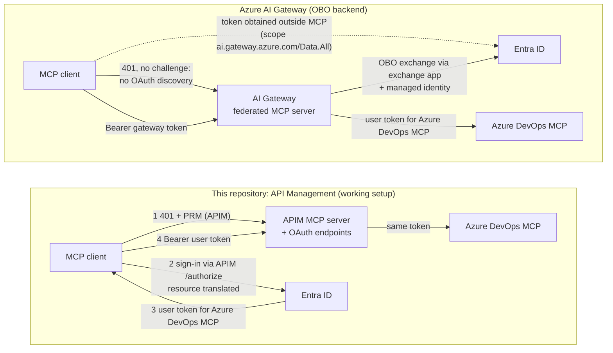

# Azure AI Gateway and the Azure DevOps MCP server

Azure AI Gateway became generally available on 2026-11-17. This page answers one question
for this repository's scenario: **can AI Gateway put the hosted Azure DevOps MCP server
behind a governed gateway, with per-user identity and working sign-in, without our custom
APIM policies?** It combines the official documentation with a live lab test (2026-11-18).

**Short answer:**

- **Per-user identity: yes, natively.** AI Gateway's OAuth **on-behalf-of (OBO)** backend
  credential exchanges the caller's token for an Azure DevOps MCP token. Azure DevOps sees the
  signed-in user. That replaces our `resource` translation for the data plane.
- **Interactive sign-in from MCP clients: no.** The gateway's MCP endpoint answers `401`
  with no `WWW-Authenticate` challenge, and it serves no protected-resource metadata (PRM) or
  authorization-server metadata. VS Code, Copilot CLI, Codex and Claude Code therefore cannot
  start an OAuth sign-in. They must be given a pre-acquired gateway token or an API key, and an
  API key carries no user, so OBO doesn't work with it.
- **Tool-argument validation: no** (allow-lists and block-lists yes).
- **Our APIM policies and fragments do not run there.** AI Gateway has a typed, JSON policy
  model, not APIM policy XML.

Terms are explained in the [glossary](GLOSSARY.md).

## What AI Gateway is

| Fact | Detail | Source |
|---|---|---|
| Product | A standalone managed gateway for AI models and MCP tools, distinct from the API Management service. It replaces the earlier "AI Gateway tier" of API Management (that preview SKU must be migrated by 2027-01-15). | [Compare with API Management](https://learn.microsoft.com/azure/ai-gateway/compare-api-management-service), [Migrate from the AI Gateway tier](https://learn.microsoft.com/azure/ai-gateway/ai-gateway-resource), [GA blog](https://techcommunity.microsoft.com/blog/IntegrationsonAzureBlog/azure-ai-gateway-is-now-generally-available-ship-faster-stay-in-control/4572644) |
| Resource type | `Microsoft.ApiManagement/aigateways` (same resource provider as APIM, different type). GA API version `2026-11-01`. Children: `workspaces/default`, `toolServers`, `modelProviders`, `models`, `aliases`, `apiKeys`, `telemetryExporters` | `az provider show -n Microsoft.ApiManagement`; [REST API](https://learn.microsoft.com/rest/api/aigateway/) |
| Management | Its own portal (`ai.gateway.azure.com`), the `az aigateway` CLI extension, ARM/Bicep | [Azure/aigateway](https://github.com/Azure/aigateway) |
| MCP model | **Federated MCP server**: one gateway MCP endpoint, `https://<gateway-host>/default/toolservers/<name>/mcp`, publishes the tools of one or more backends (remote MCP, OpenAPI, connectors) with a namespace prefix (`ado_core_list_projects`) | [Concepts](https://learn.microsoft.com/azure/ai-gateway/concepts) |
| Caller authentication | Microsoft Entra token for the gateway's own resource (`https://ai.gateway.azure.com/Data.All`, app "Azure AI Gateway Dataplane") plus an RBAC role (AI Gateway Tools User), or a gateway-wide runtime API key | `skills/use-ai-gateway/references/authentication.md` in Azure/aigateway |
| Backend authentication | Per backend: none, static headers, managed identity, OAuth 2.0 (shared connected account), or OAuth 2.0 **on behalf of** the caller | In-product docs "Access backends with user credentials"; REST spec 2026-11-01 |
| Policies | Typed JSON policies: token, cost and request-rate limits, IP filter, CORS, tool threat protection (Agent 365), agent hooks (`preToolCall`/`postToolCall` callbacks). No XML policies, fragments or named values | `skills/manage-ai-gateway/references/policies.md`; FAQ ("keep using API Management for ... custom XML policies") |
| Observability | OpenTelemetry metrics, logs and traces over OTLP to Application Insights or any OTLP endpoint; built-in Monitoring page | Lab 13 in Azure/aigateway |
| Price | Free until billing starts on 2027-01-01. Then, per the GA blog, free up to 10,000 requests a month, and $500 a month per gateway including 10 million requests, plus $20 per additional million. **Check the pricing page before relying on this.** No SKU or capacity to choose | GA blog |

Documentation status on 2026-11-18: some Learn pages still say "public preview" and list two
regions. The resource provider already offers the GA API version in 16 regions.

## Architecture compared



| | API Management (this repository) | Azure AI Gateway |
|---|---|---|
| Token the client holds | Azure DevOps MCP token (audience Azure DevOps) | AI Gateway token (audience `ai.gateway.azure.com`) |
| Token Azure DevOps receives | The client's token, unchanged | A new token from an OBO exchange, still the user |
| How the client gets its token | Standard MCP OAuth discovery, served by APIM policies | Outside MCP: Azure CLI, MSAL code, or a pasted token. No discovery |
| MCP handling | APIM MCP server (native pass-through); the server's tool names and sessions | Gateway terminates MCP and federates tools; names get a namespace prefix |
| Governance | APIM policy XML (fragments, named values); argument validation possible only as an optional add-on, not deployed ([TOOL-VALIDATION.md](TOOL-VALIDATION.md)) | Typed policies, tool allow-list and block-list, agent hooks |

## Requirement matrix

Evidence: **live** = tested in the lab on 2026-11-18; **docs** = official documentation only.

| # | Requirement | Native in AI Gateway | Evidence |
|---|---|---|---|
| 1 | Expose the existing hosted Azure DevOps MCP server | **Yes** (as a federated backend, not a byte-for-byte pass-through) | live: `tools/list` returned the server's 43 tools as `ado_*`; `tools/call` succeeded with OBO |
| 2a | OAuth discovery for MCP clients (401 challenge, PRM, authorization-server metadata) | **No** | live: `401 {"message":"Unauthorized. Missing or invalid Entra ID token, or missing Data.All scope."}` without `WWW-Authenticate`; every `/.well-known/oauth-protected-resource*`, `/.well-known/oauth-authorization-server` and `/.well-known/openid-configuration` URL returns `404` |
| 2b | Upstream PRM `resource` / `resource_metadata` preserved or configurable | **Not applicable**: the gateway neither forwards nor rewrites the upstream PRM; the client never sees it | live: no backend discovery reaches the client; the `none` backend's `401` became a gateway `502` |
| 2c | DCR / client ID metadata documents | **No** | live: Codex `Registration failed: HTTP 404`; Claude Code `Dynamic Client Registration rejected (HTTP 404)` |
| 2d | OBO / user-delegated downstream token | **Yes** | live: `ado-obo` server, `tools/call core_list_projects` returned the user's projects; the same call with the gateway's managed identity failed with `VS30063` |
| 2e | Shared credential (Credential Manager equivalent) | **Yes** (OAuth 2.0 shared connected account, managed identity, header) | docs; managed identity tested live (app-only, not an Azure DevOps user) |
| 3 | Per-user identity end to end at Azure DevOps | **Yes, with OBO and a delegated Entra caller token**. **No** with API keys (`tools/list` → `502`) or managed identity | live |
| 4a | Tool-argument validation against `inputSchema` | **No** | live: `top: 500`, `top: "5"` and the unknown property `query` all reached Azure DevOps. A `preToolCall` agent hook (your own service) is the documented extension point (docs, not tested) |
| 4b | Tool allow-list / block-list | **Yes** | live: allow-list `ado_core_list_projects`, `ado_wit_work_item` → `tools/list` shows 2 tools; calling a hidden tool → HTTP 400, JSON-RPC `-32602 "Unknown tool."` |
| 4c | Server-side read-only restriction (`X-MCP-Readonly`) | **Partial**: a static backend header works only without token authentication; with OBO use the allow-list instead | live: adding `X-MCP-Readonly` to the OBO backend failed with *This owner's current runtime cannot combine token authentication and supplemental headers.*; 43 tools (write tools included) were listed until the allow-list was set |
| 5 | Run our APIM policies and fragments | **No**: different policy engine | docs (FAQ, migration tool: "Named values, policy fragments — No equivalent"; transformations `set-body`, `set-header` — gap) |
| 6 | Observability (request logs, App Insights, tool-level telemetry) | **Yes, different shape**: OTLP metrics/logs/traces, `OTelSpans`/`OTelLogs` tables, MCP semantic conventions; no `ApiManagementGatewayMCPLog` | docs (lab 13); not configured in this lab |
| 7 | Client compatibility (interactive sign-in) | **No** for VS Code, Copilot CLI, Codex, Claude Code. **Yes** with a pre-acquired token in a header | live: Codex (`bearer_token_env_var`) and Copilot CLI (`headers`) called tools as the user; Claude Code connected with a header; Codex and Claude OAuth sign-in failed at DCR. VS Code: not tested (same discovery path) |
| 8 | Lab-friendly tier, regions, limits | **Yes**: no SKU choice, deploys in about a minute, free until 2027-01-01 | live deployment in Sweden Central; docs for pricing |

## Live test details

Lab: a new resource group in the same subscription as the APIM lab, Sweden Central,
deployed with [`infra/aigateway/main.bicep`](../infra/aigateway/main.bicep). The APIM lab
was not changed. Three MCP servers point at the same Azure DevOps organization:

| Server | Backend credential | `tools/list` | `tools/call core_list_projects` |
|---|---|---|---|
| `ado-none` | none | `502` *An upstream tool server returned an invalid or unsuccessful response.* | — |
| `ado-mi` | gateway user-assigned managed identity, resource `https://mcp.dev.azure.com` | 43 tools | `isError: true`, `VS30063: You are not authorized to access https://dev.azure.com.` (the identity is not an Azure DevOps user) |
| `ado-obo` | OAuth 2.0 on behalf of the caller | 43 tools (2 with the allow-list) | the user's projects |

Probe ([`tools/probe.aigateway.example.json`](../tools/probe.aigateway.example.json)):
`20 checks, 11 expected failures, 0 unexpected`. The expected failures are the missing
discovery and client sign-in on all three servers, the managed-identity call, and the
`none` backend.

The Entra check that decides any future fix:

| Authorization request (public client, scope `https://ai.gateway.azure.com/Data.All`) | Entra |
|---|---|
| `resource=https://ai.gateway.azure.com` | Sign-in page served |
| `resource=https://<gateway-host>/default/toolservers/ado-obo/mcp` | `AADSTS9010010` |

So the same rule applies as with APIM: if a gateway ever advertised PRM whose `resource` is
its own URL, Entra would reject the sign-in exactly like the reported problem, unless the
gateway also translates `resource`.

### Setting up OBO (what we did)

1. Create the gateway's service principal in the tenant once:
   `az ad sp create --id 18550318-e177-4205-a743-6816d6fcdc3f` (Azure AI Gateway Dataplane).
2. Create a single-tenant **token exchange** app registration:
   - Expose an API: identifier URI `api://<exchange-app-id>`, scope `FederationApp.Access`.
   - Authorized client applications: `18550318-e177-4205-a743-6816d6fcdc3f` with that scope.
   - API permissions: Azure DevOps MCP (`2a72489c-aab2-4b65-b93a-a91edccf33b8`), delegated
     `Ado.Mcp.Tools`, with admin consent.
   - Federated credential: issuer `https://login.microsoftonline.com/<tenant-id>/v2.0`,
     subject = the gateway's user-assigned identity **object ID**, audience
     `api://AzureADTokenExchange`. No client secret.
3. Deploy with `oboExchangeAppId = '<exchange-app-id>'`. The Bicep sets:

   ```bicep
   authentication: {
     oauth2: {
       grantType: 'tokenExchange'          // required; not in the published 2026-11-01 enum
       tokenExchange: {
         profile: 'entraOnBehalfOf'
         federatedClientApplication: {
           applicationId: '<exchange-app-id>'
           appCredential: { type: 'userAssignedManagedIdentity', clientId: '<uami-client-id>' }
         }
         scopes: [ 'https://mcp.dev.azure.com/Ado.Mcp.Tools' ]
       }
     }
   }
   ```

   Validation errors we hit on the way, in order: `Tool server type must be a supported
   value` (use `toolServerType`, not `type`); `OAuth2 tokenUrl is required`; `OAuth2
   clientSecret is required`; `OAuth2 tokenExchange cannot be combined with client
   credentials, authorization code, discovery, or server-managed token fields`. The working
   combination is `grantType: 'tokenExchange'` with nothing but `tokenExchange`.
4. Give each user **AI Gateway Tools User** on the gateway or the MCP server
   (`callerPrincipalId` does it for one user).

### Client configuration that works today (pre-acquired token)

```powershell
$env:AIGW_TOKEN = az account get-access-token --scope https://ai.gateway.azure.com/Data.All --query accessToken -o tsv
```

| Client | Configuration | Result (live) |
|---|---|---|
| OpenAI Codex CLI | `[mcp_servers.ado_aigw]` `url = "https://<gateway-host>/default/toolservers/ado-obo/mcp"`, `bearer_token_env_var = "AIGW_TOKEN"` | `codex exec` listed the user's projects |
| GitHub Copilot CLI | `{"type":"http","url":"…/ado-obo/mcp","headers":{"Authorization":"Bearer <token>"}}` | `copilot -p` listed the user's projects |
| Claude Code | `claude mcp add --transport http ado-aigw <url> --header 'Authorization: Bearer ${AIGW_TOKEN}'` | `✔ Connected` |
| Any client, OAuth | URL only | Fails: no challenge, PRM or registration endpoint |

The token expires after about an hour and must be refreshed outside the client. That is
acceptable for automation and agents, but not as an end-user sign-in experience in VS Code.

## Gaps

1. **No MCP OAuth discovery.** This is the blocking gap for end users in VS Code and the CLIs.
   The documented client examples use runtime keys or tokens obtained outside MCP.
2. **API keys cannot carry the user.** OBO needs a delegated Entra token; with a key the OBO
   backend fails (`502`).
3. **No tool-argument validation**: only allow-lists and block-lists. Validation needs a
   `preToolCall` hook service that you build and run.
4. **No request transformation** (`set-header`): the Azure DevOps `X-MCP-Readonly` and
   `X-MCP-Toolsets` headers cannot be added alongside OBO (the service rejects token
   authentication plus supplemental headers); use the allow-list.
5. **Different tool names** (`ado_` prefix) and a gateway-terminated MCP session: client
   configuration and prompts that name tools must change.
6. **Documentation drift**: the published 2026-11-01 REST spec omits `grantType:
   tokenExchange`, the lab samples use an older schema (`type`, `credentials`, `mcp.url`), and
   some Learn pages still say preview.
7. **Separate token audience**: every client needs consent for "Azure AI Gateway Dataplane"
   `Data.All`; organizations with restricted consent must grant it.

## Recommendation

- **For people using VS Code or the CLIs interactively (the reported scenario):** keep the
  **API Management working setup** of this repository. It is still the only option tested
  here in which standard MCP clients sign in by themselves and keep the user's identity.
- **For agents, automation and Foundry-hosted workloads that can obtain an Entra token
  themselves:** AI Gateway with an **OBO** backend works natively for Azure DevOps MCP and
  needs no custom policy. Add an allow-list instead of `X-MCP-Readonly`.
- **Possible combined design (not built):** keep the APIM OAuth facade from this repository,
  but have `/authorize` and `/token` translate `resource` to `https://ai.gateway.azure.com`
  and the scope to `https://ai.gateway.azure.com/Data.All`, then forward MCP calls to AI
  Gateway, which does OBO to Azure DevOps. Entra accepts that authorization request (see above).
  It adds a hop, and is only worth it if AI Gateway's governance is required.
- **Ask the product group** for RFC 9728 discovery on AI Gateway MCP endpoints, with a
  `resource` that Entra accepts (see [ANALYSIS.md](ANALYSIS.md#7-open-questions-for-the-product-groups)).

## Migration notes (API Management → AI Gateway)

| API Management (this repository) | AI Gateway |
|---|---|
| `/ado-mcp-proxy/<org>` | `/default/toolservers/<name>/mcp`, one server per organization |
| User's Azure DevOps token passed through | OBO backend with an exchange app and federated credential |
| OAuth compatibility endpoints | None; clients need a gateway token from elsewhere |
| `mcp-org-validation`, allow-list of organizations | One registered MCP server per allowed organization |
| `X-MCP-Readonly` / `X-MCP-Toolsets` | Tool allow-list (`allowList`) |
| Tool argument validation (optional, not deployed here) | `preToolCall` agent hook (custom service) |
| Rate limit per IP | `requestRateLimit` per identity or IP |
| App Insights `<trace>` + `ApiManagementGatewayLogs` | OTLP telemetry exporter |

The [`tools/migrate-apim`](https://github.com/Azure/aigateway/tree/main/tools/migrate-apim)
tool in Azure/aigateway inventories an APIM instance and reports what can move.

## Deploy, test, clean up

```powershell
az group create -n <rg> -l swedencentral
Copy-Item infra/aigateway/main.example.bicepparam infra/aigateway/main.local.bicepparam   # set names, organization, your object ID
az deployment group create -g <rg> --parameters infra/aigateway/main.local.bicepparam
# after creating the exchange app (above): add  param oboExchangeAppId = '<id>'  and redeploy

Copy-Item tools/probe.aigateway.example.json tools/probe.aigateway.local.json            # set <gateway-host>
$env:MCP_ACCESS_TOKEN = az account get-access-token --scope https://ai.gateway.azure.com/Data.All --query accessToken -o tsv
python tools/mcp_probe.py --config tools/probe.aigateway.local.json --token env

az group delete -n <rg>     # and delete the exchange app registration
```

Cost: nothing until billing starts on 2027-01-01. Delete the lab gateway before then.

## Sources

- AI Gateway overview, concepts and comparison with API Management: <https://learn.microsoft.com/azure/ai-gateway/overview>, <https://learn.microsoft.com/azure/ai-gateway/concepts>, <https://learn.microsoft.com/azure/ai-gateway/compare-api-management-service>
- GA announcement: <https://techcommunity.microsoft.com/blog/IntegrationsonAzureBlog/azure-ai-gateway-is-now-generally-available-ship-faster-stay-in-control/4572644>
- REST API: <https://learn.microsoft.com/rest/api/aigateway/>; spec `specification/apimanagement/resource-manager/Microsoft.ApiManagement/AIGateway/stable/2026-11-01` in [Azure/azure-rest-api-specs](https://github.com/Azure/azure-rest-api-specs)
- CLI, labs, skills and migration tool: <https://github.com/Azure/aigateway>
- Govern MCP tools in Foundry through a gateway: <https://learn.microsoft.com/azure/foundry/agents/how-to/tools/governance>
- MCP authorization (discovery requirements): <https://modelcontextprotocol.io/specification/2025-11-25/basic/authorization>
