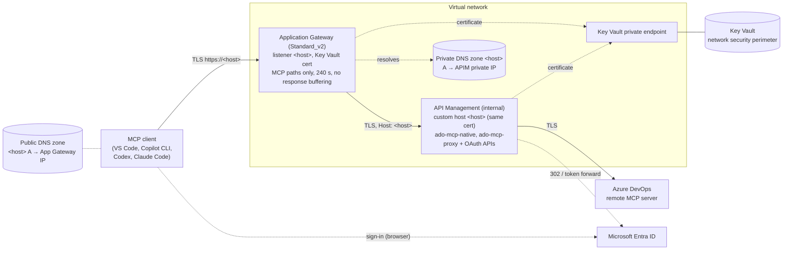

# Behind Application Gateway: custom domain, APIM in internal mode

This guide puts both setups behind **Azure Application Gateway** on a custom domain, with
**API Management in internal virtual network mode**, the way an enterprise usually runs a
gateway: clients only see `https://<host>`, APIM has no public data-plane endpoint, and only
the MCP paths are exposed. It covers the architecture, the SKU, DNS, certificates, Key Vault
networking, routing, timeouts and streaming, rate limiting, logs, cost, an alternative
without a custom domain on APIM, and the results of the tests run through it (lab,
2026-11-18).

**Prerequisites:** the lab from [Getting started](GETTING-STARTED.md) (Entra public client,
Azure DevOps organization, Log Analytics), a domain delegated to an Azure DNS zone (any
subscription or tenant), and Contributor plus User Access Administrator (or Owner) on the
resource group.

## 1. Architecture



The **same host name is used end to end** (split-horizon DNS): public DNS points `<host>` at
Application Gateway; inside the virtual network a private DNS zone named after the host
points it at APIM's internal IP. Application Gateway sends `Host: <host>` and SNI `<host>` to
APIM, and APIM has `<host>` configured as a custom gateway host name with the same
certificate. Every URL APIM and the policies build from the request is then already the
public one, and both setups behave exactly as on a plain gateway.

### Why the host name matters

| Behaviour (verified in the lab) | Consequence |
|---|---|
| APIM answers **404** to a `Host` it does not have configured | A proxy that forwards an unknown host reaches nothing |
| APIM builds the MCP servers' `401` `resource_metadata` URL, and the regular setup's built-in PRM `resource`, from the request host; no policy can change them | If the proxy sends APIM's default `*.azure-api.net` host, clients are told about an internal host they cannot reach |
| The working setup's PRM (`resource`, `authorization_servers`) and OAuth metadata (`issuer`, endpoints) use the request host (or a trusted `X-Forwarded-Host`, [section 9](#9-alternative-no-custom-domain-on-apim)) | `resource` must equal the URL the client connected to (RFC 9728 §3.3); VS Code, Claude Code and the probe reject a mismatch |

[`tools/mcp_probe.py`](../tools/mcp_probe.py) checks this for every target: *discovery: URLs
on the client's host*.

## 2. Application Gateway SKU

| | Basic (preview) | Standard_v2 (lab) | WAF_v2 |
|---|---|---|---|
| Price, West Europe (November 2026) | ≈ $0.03/h fixed + capacity units | ≈ $0.26/h fixed + capacity units (≈ $190/month if never stopped) | higher than Standard_v2 |
| SLA | 99.9 % | 99.95 % | 99.95 % |
| Key Vault certificates, path rules, header rewrite, backend host name, custom probe, backend timeout, response-buffering switch | ✓ (buffering switch documented for Standard_v2) | ✓ | ✓ (request buffering always on) |
| Autoscaling | — | ✓ (template: 0–2) | ✓ |
| Scale limits | 200 connections/s, 5 listeners, 5 pools, 5 rules | 62 500 connections/s, 100+ of each | as Standard_v2 |
| WAF, URL rewrite, mTLS, Private Link, private-only, TCP/TLS proxy | — | ✓ (no WAF) | ✓ |

Basic would be enough functionally and costs about a tenth. **In the lab it did not
provision**: after registering the preview (`AllowApplicationGatewayBasicSku`), even a
minimal Basic gateway (HTTP listener, one backend, basic rule) ended in `Failed` with
`InternalServerError` and no detail, while the identical minimal Standard_v2 in the same
subnet succeeded. The template therefore defaults to **Standard_v2** (`appGatewaySku`);
try Basic in your subscription if cost matters, and pick **WAF_v2** for production edge
protection ([section 10](#10-waf-considerations)).

## 3. What gets deployed

[`infra/edge/main.bicep`](../infra/edge/main.bicep); the MCP APIs are still deployed by
[`infra/main.bicep`](../infra/main.bicep):

| Resource | Details |
|---|---|
| Virtual network | `snet-appgw` (/24), `snet-apim` (/27), `snet-private-endpoints` (/27). App Gateway NSG: `GatewayManager` 65200–65535, `AzureLoadBalancer`, `Internet` 443. APIM NSG: 443 from the App Gateway subnet, `ApiManagement` 3443, `AzureLoadBalancer` 6390; outbound `Storage` 443, `Sql` 1433, `AzureKeyVault` 443, `AzureMonitor` 1886/443 |
| API Management | New Developer instance, `virtualNetworkType: Internal`, no public IP resource. User-assigned identity for the certificate; custom gateway host `<host>` from Key Vault (stage 2) |
| Key Vault | RBAC, soft delete, **private endpoint** with `privatelink.vaultcore.azure.net` linked to the network, and `publicNetworkAccess: SecuredByPerimeter` in a **network security perimeter** ([section 5](#5-key-vault-networking)) |
| Managed identities | One for App Gateway, one for APIM, both *Key Vault Secrets User*. You get *Key Vault Certificates Officer* (`certificateOfficerPrincipalId`) |
| Private DNS zone | Named `<host>` (no other name of the domain is shadowed), apex A record → APIM private IP |
| Application Gateway | Public IP; HTTPS listener for `<host>` (SNI, TLS 1.2+ policy `AppGwSslPolicy20220101`); one path rule to the APIM pool, other paths to an empty pool; backend HTTPS 443 with host name `<host>`; probe `/status-0123456789abcdef`; timeout 240 s; response buffering off; rewrite set `X-Forwarded-Host = {var_host}`; access logs to Log Analytics |

**Two stages**, because the certificate needs the vault first and APIM takes 30–45 minutes:

1. `certificateName = ''`: network, Key Vault, identities, APIM (internal). Create the
   certificate meanwhile ([section 4](#4-dns-and-certificate)).
2. `certificateName = '<name>'`: APIM custom host name (another 15–45 minutes), private DNS,
   Application Gateway.

### Deploy

```powershell
az feature register --namespace Microsoft.Network --name AllowApplicationGatewayBasicSku   # only for Basic
Copy-Item infra/edge/main.example.bicepparam infra/edge/main.local.bicepparam             # fill in
az deployment group create -g <rg> -n edge-stage1 -f infra/edge/main.bicep -p infra/edge/main.local.bicepparam

# MCP APIs into the new instance: a copy of main.local.bicepparam with
#   apimName = '<internal-apim>', trustForwardedFor = true
#   (and workspaceName / appInsightsName to share the existing telemetry)
az deployment group create -g <rg> -f infra/main.bicep -p infra/main.edge.local.bicepparam

# certificate (section 4), then set certificateName and run stage 2
az deployment group create -g <rg> -n edge-stage2 -f infra/edge/main.bicep -p infra/edge/main.local.bicepparam

# publish the host: A record <host> -> output appGatewayPublicIp (zone may be in another tenant)
az network dns record-set a add-record -g <dns-rg> -z <domain> -n <label> -a <appGatewayPublicIp> --subscription <dns-subscription>

# Codex redirect URIs for the new URLs
./scripts/setup-entra.ps1 -TenantId <tenant-id> -AppName <existing-app-name> `
  -McpUrl https://<host>/ado-mcp-proxy/<org>, https://<host>/ado-mcp-proxy, https://<host>/ado-mcp-native/<org>
```

Pass `-AppName` with your existing public client's display name: without it the script
creates a new app called `ado-mcp-apim-client` (this happened in the lab; the extra app was
deleted).

## 4. DNS and certificate

**Delegation first.** The domain must really be delegated to the Azure DNS zone: compare
`az network dns zone show --query nameServers` with the name servers at the registrar. In the
lab the registrar pointed at a different Azure DNS name-server set than the zone's own, so
public resolvers got `REFUSED` (lame delegation) until the registrar was updated. On a VPN
whose resolver answers from a private zone of the same name, test public resolution with
DNS-over-HTTPS (`https://dns.google/resolve?name=<host>&type=A`).

**Certificate.** [`scripts/request-certificate.ps1`](../scripts/request-certificate.ps1)
issues and renews it with **Let's Encrypt**; the private key never leaves Key Vault:

1. Key Vault creates the key and a certificate signing request (issuer `Unknown`).
2. Posh-ACME orders a certificate for that request and proves control of the domain with a
   DNS-01 TXT record `_acme-challenge.<host>` in the Azure DNS zone, then deletes it.
3. The issued chain is merged into the Key Vault certificate.

```powershell
Install-Module Posh-ACME -Scope CurrentUser
./scripts/request-certificate.ps1 -KeyVaultName <vault> -CertificateName <name> -HostName <host> `
  -KeyVaultSubscriptionId <sub> -DnsSubscriptionId <dns-sub>
```

Any other CA works the same way: submit the CSR from `az keyvault certificate pending show`,
then `az keyvault certificate pending merge --file <chain.pem>`.

**Renewal.** Let's Encrypt certificates last about 90 days. Rerun the script before expiry
with your IP in `operatorAddressPrefixes`. App Gateway and APIM reference the
**versionless** secret URI and pick up the new version from Key Vault without a
redeployment (both poll about every 4 hours).

## 5. Key Vault networking

Many organizations enforce `publicNetworkAccess = Disabled` on key vaults with an Azure
Policy *modify* effect (in the lab: a governance policy that exempts only
`SecuredByPerimeter` and a waiver tag). `Disabled` still admits trusted services, but blocks
you from creating the certificate request. The template therefore uses:

| Path | Who | Why |
|---|---|---|
| Network security perimeter, `SecuredByPerimeter`, inbound rule for your IP (`operatorAddressPrefixes`) | You: certificate request, merge, renewal | Satisfies the policy; remove your IP afterwards (`[]`) |
| Perimeter inbound rule for this subscription | Managed identities | APIM loaded its certificate this way |
| Private endpoint + `privatelink.vaultcore.azure.net` | App Gateway (and APIM) | **App Gateway could not load the certificate through the perimeter alone** (its `sslCertificates` entry stayed `Failed`); private endpoint traffic bypasses perimeter rules |

## 6. Routing

Only these paths reach APIM; every other path goes to an empty pool and gets **502**
(`ERRORINFO_EMPTY_BACKEND_POOL`), so other APIs on the same instance stay unreachable:

| Path | Serves |
|---|---|
| `/ado-mcp-proxy`, `/ado-mcp-proxy/*` | Working setup: MCP server, PRM, OAuth endpoints |
| `/.well-known/oauth-protected-resource/ado-mcp-proxy`, `.../ado-mcp-proxy/*` | PRM discovery alias |
| `/.well-known/oauth-authorization-server/ado-mcp-proxy/*` | OAuth metadata alias (Codex, Claude Code, Copilot CLI) |
| `/.well-known/openid-configuration/ado-mcp-proxy/*` | OpenID metadata alias |
| `/ado-mcp-native`, `/ado-mcp-native/*` | Regular setup |
| `/.well-known/{oauth-protected-resource,oauth-authorization-server,openid-configuration}/ado-mcp-native...` | So clients get APIM's `404` there, as without a proxy |

The aliases are required: without them Codex and Claude Code fail to sign in to the working
setup ([README](../README.md#isolation-the-working-setup-owns-one-dedicated-path)).

One visible difference remains: clients that fall back to the **host root**
(`/.well-known/oauth-protected-resource`) get App Gateway's `502` instead of APIM's `404`.
Codex on the regular setup reports *OAuth metadata discovery failed ... 502 Bad Gateway*
instead of *Dynamic registration failed: HTTP 404*; it fails in both cases. Route the root
well-known paths to APIM only if no other API on the instance answers there.

## 7. Timeouts and streaming

| Setting | Value | Measured (temporary API streaming a 10 s response, first byte after 2 s) |
|---|---|---|
| Response buffering | off (`responseBuffering = false`) | Off: first byte 2.5 s, end 10.5 s, same as calling the backend directly. **On: first byte = end = 10.5 s** (the whole stream is held, so SSE events would arrive late) |
| Backend request timeout | 240 s (`backendTimeoutSeconds`) | Lowered to 5 s: a response whose first byte took 8 s got **504** after 5 s (`ERRORINFO_UPSTREAM_TIMED_OUT`); a stream sending every 2 s for 9 s completed. The timeout limits waiting for the backend, not stream length |
| Request buffering | on | MCP requests are small JSON-RPC bodies; WAF_v2 cannot turn it off anyway |

For your own APIs behind APIM, note that APIM itself buffers non-MCP responses unless
`forward-request` has `buffer-response="false"`.

## 8. Rate limiting behind a proxy

Behind App Gateway every request reaches APIM from an App Gateway instance, so
`context.Request.IpAddress` is a few private addresses shared by all users. With
`trustForwardedFor = true` (named value `mcp-trust-forwarded-for`) the working setup takes
the client IP from the **last** `X-Forwarded-For` entry, the one App Gateway appended
(earlier entries come from the client and can be forged), without the port.

| Test (60 calls / 60 s) | Result |
|---|---|
| Two source IPs (a container in Azure and a workstation), trust on | Container: 60 × `401`, then `429`. Workstation right after: `401` (own budget) |
| Same, trust off (previous behaviour) | Container: 120 × `401` (two App Gateway instances × 60), then `429`. **Workstation right after: all `429`** (shared budget) |
| One IP, a different forged `X-Forwarded-For` per call, trust on | 60 × `401`, then `429` (forging does not help) |

`rateLimitKey = 'user'` (named value `mcp-rate-limit-key`) keys the limit on the token's `oid`
instead, so users behind one NAT get separate budgets. The gateway does not validate the
token, so a caller could invent `oid` values; combine it with `validate-azure-ad-token`.
Keep `trustForwardedFor = false` when clients reach APIM directly: they could then set these
headers themselves.

## 9. Alternative: no custom domain on APIM

`appGatewayBackendHost = 'apim-default'` (with `apimCustomDomain = false` for a real
deployment) sends APIM's default `<apim-name>.azure-api.net` host instead. The template then
adds a private `azure-api.net` zone and an App Gateway response rewrite that puts the public
host back into `WWW-Authenticate`; the working setup's policies build their URLs from
`X-Forwarded-Host` (set by App Gateway, trusted only with `trustForwardedFor`).

| | Custom host on APIM (default) | Default APIM host + rewrites |
|---|---|---|
| Certificate and Key Vault access for APIM, host-name update (15–45 min) | needed | not needed |
| Working setup | ✅ all probe checks | ✅ all probe checks (challenge rewritten, metadata from `X-Forwarded-Host`) |
| Working setup without trusting `X-Forwarded-Host` | – | ❌ PRM `resource` and issuer name the internal host; the client rejects the PRM |
| Regular setup | Fails at Entra (`AADSTS9010010`), as on a plain gateway | Fails **earlier**: APIM's built-in PRM names the internal host (App Gateway cannot rewrite bodies), so clients reject it before reaching Entra |
| Moving parts | DNS + certificate on both | header rewrite, forwarded-host trust, `azure-api.net` private zone |

Use the custom host unless a certificate on APIM is not an option.

## 10. WAF considerations

Not deployed in the lab. If you need it (`appGatewaySku = 'WAF_v2'` plus a WAF policy):

- Start in **Detection** mode and review `AGWFirewallLogs` while every client signs in and
  calls tools.
- Expect false positives on `/ado-mcp-proxy/oauth/authorize` (long query strings with URLs:
  `redirect_uri`, `resource`, `scope`) and on JSON-RPC bodies (tool arguments with code,
  WIQL or markdown). Add **scoped exclusions** (per rule, per argument, per path with a
  per-URI WAF policy) rather than disabling rule groups.
- Request buffering is always on with WAF; responses can still stream.
- Never log `Authorization`.

## 11. Logs

App Gateway access logs go to the lab workspace (resource-specific table `AGWAccessLogs`):
[`docs/kql/appgw-access.kql`](kql/appgw-access.kql). `BackendPoolName` shows the route
(`apim` or `unrouted`), `HttpStatus` what the client got, `ServerStatus` what APIM returned,
`ErrorInfo` App Gateway's reason (`ERRORINFO_EMPTY_BACKEND_POOL`,
`ERRORINFO_UPSTREAM_TIMED_OUT`), `ClientIp` the real client. Within minutes of going live,
internet scanners show up as `unrouted` `502`s. APIM logs and traces work as before
([OBSERVABILITY.md](OBSERVABILITY.md)); follow a call across both with the time and the
`x-apim-request-id` response header.

## 12. Cost

App Gateway (Standard_v2) and the second APIM Developer instance bill per hour while they
exist. Stop App Gateway between test sessions (configuration and public IP stay):

```powershell
az network application-gateway stop  -g <rg> -n <app-gateway>
az network application-gateway start -g <rg> -n <app-gateway>
```

APIM Developer cannot be stopped; delete the edge resources when you are done.

## 13. Test results

Lab, 2026-11-18, App Gateway Standard_v2 → APIM Developer (internal, custom host).

| Test | Result |
|---|---|
| Probe through `https://<host>` (`agw-proxy`, `agw-proxy-bare`, `agw-native`, with token) | ✅ 35 checks; the only failure is the expected `AADSTS9010010` on the regular setup. Every advertised URL is on `<host>`; `tools/list` and `tools/call` work on both setups |
| Routing and negative checks | ✅ unrouted paths (`/status-0123456789abcdef`, root `/.well-known/oauth-authorization-server`, other APIs) → `502`; the three aliases → `200`; native alias → APIM `404`; `https://<public-ip>` → `404`; forged `X-Forwarded-Host` overridden by App Gateway; the internal `*.azure-api.net` host does not resolve publicly |
| Streaming, timeout | ✅ [section 7](#7-timeouts-and-streaming) |
| Rate limit, two sources | ✅ [section 8](#8-rate-limiting-behind-a-proxy) |
| Logs | ✅ `AGWAccessLogs` with route, status, error info, client IP ([section 11](#11-logs)) |
| Default APIM host + rewrites | ✅ working setup / ⚠️ regular setup fails earlier ([section 9](#9-alternative-no-custom-domain-on-apim)) |
| OpenAI Codex CLI 0.167.0 | ✅ working setup: signed in (`Auth: OAuth`), authorize URL at `https://<host>/ado-mcp-proxy/oauth/authorize` with `resource=https://<host>/...`. ❌ regular setup: *discovery failed ... 502* (plain gateway: *registration 404*, [section 6](#6-routing)). `tools/call` through App Gateway not run |
| VS Code, GitHub Copilot CLI, Claude Code, MCP Inspector | ⏳ **pending**: to be run manually through `https://<host>` (both setups) with an enterprise Copilot seat (enterprise policy *MCP servers in Copilot* enabled) |
| Application Gateway **Basic** (preview) | ❌ did not provision in the lab subscription ([section 2](#2-application-gateway-sku)) |
