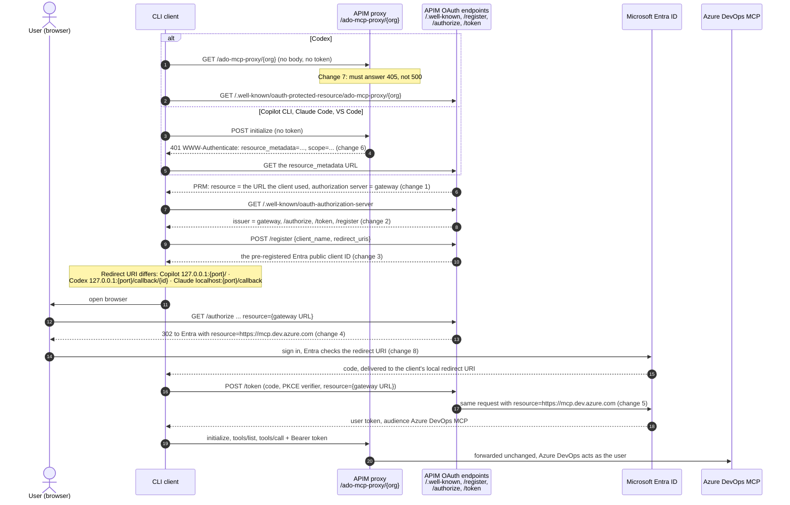

# What API Management changes so MCP clients can sign in (and why)

This page is for anyone who has to explain or rebuild the **working setup**, not only
identity experts. It lists every change made in Azure API Management (APIM) so that the
command-line agents **GitHub Copilot CLI**, **OpenAI Codex CLI** and **Claude Code** (and,
for comparison, **VS Code**) can sign in and use the hosted Azure DevOps MCP server through
the gateway. For each change you get:

1. **What the client does**, in plain language.
2. **What breaks without the change**, as observed in the lab.
3. **The exact APIM change**: policy file, element, before/after snippet.
4. **Why it is safe**, and the spec it relates to.
5. **How to verify it**: a command, the expected output, and a KQL query.

The README's Diagram 2 numbers the same policies in request order. Here they are numbered by
what clients need: Diagram 2 change 1 = change 6 here, 2 = 1, 3 = 2, 4 = 3, 5 = 4, 6 = 5, and
Diagram 2 change 7 (forwarding the user's token unchanged) applies to every client alike.
Changes 7–9 here are new for the command-line clients.

Everything marked *observed* was seen in lab sign-ins on 2026-11-18 with Copilot CLI
1.0.113, Codex CLI 0.167.0 and Claude Code 2.1.322. Anything not seen is marked
*unverified*. Hostnames, tenants and IDs are placeholders. Unfamiliar terms are explained
in [the glossary](GLOSSARY.md). Per-client setup steps are in [docs/clients](clients/README.md).

## The idea in one paragraph

An MCP client that gets `401 Unauthorized` goes on a short treasure hunt. The server tells it
where the **protected-resource metadata** ([PRM](GLOSSARY.md#prm)) is, a small JSON file
that names the API and who issues its keys. The client then reads the **authorization
server metadata** (the key issuer's address book). It gets a **client ID**: either it asks
the issuer to register it ([DCR](GLOSSARY.md#dcr)) or it is told one. It then opens a browser
so the user can sign in, and the browser comes back to a small web server on the user's own
machine (the [redirect URI](GLOSSARY.md#redirect-uri)). Finally it swaps the one-time code
for a token. On every step it says which API the token is for: the
[resource indicator](GLOSSARY.md#resource-indicator). Microsoft Entra issues the keys for
Azure DevOps, but it **has no registration desk** (no DCR) and **refuses a resource name it
does not know**, such as a gateway URL. The working setup lets APIM play the address book
and the registration desk, and translate the resource name, while the user's real Azure
DevOps token flows through untouched.

## Summary: which client needs which change

✅ = the client needs this change and the lab shows it working. ⚪ = not used by this
client. ⚠️ = safety net; the client did not need it in the lab, but versions have needed it
(see the linked issues).

| # | APIM change (file) | Copilot CLI | Codex CLI | Claude Code | VS Code |
|---|---|---|---|---|---|
| 1 | PRM per exact URL (`oauth-prm.xml`) | ✅ | ✅ found via path-inserted URL | ✅ checks `resource` = URL | ✅ checks `resource` = URL |
| 2 | Authorization-server metadata, issuer = gateway (`oauth-as-metadata.xml`) | ✅ | ✅ | ✅ | ✅ |
| 3 | Dynamic client registration answer (`oauth-register.xml`) | ✅ | ✅ | ✅ | ✅ |
| 4 | `/authorize`: replace `resource`, add `scope` if missing, require PKCE (`oauth-authorize.xml`) | ✅ (scope ⚠️) | ✅ (scope ⚠️) | ✅ (scope ⚠️) | ✅ |
| 5 | `/token`: same translation (`oauth-token.xml`) | ✅ | ✅ | ✅ | ✅ |
| 6 | 401 challenge points to APIM metadata, with `scope` (`proxy-mcp.xml` outbound) | ✅ | ⚪ uses well-known URLs | ✅ | ✅ |
| 7 | Body-less `GET`/`DELETE` must not fail (`tool-validation.xml` null guard) | ⚪ | ✅ | ⚪ | ⚪ |
| 8 | Redirect URIs on the Entra public client (`scripts/setup-entra.ps1`, not APIM) | `http://127.0.0.1/` | `http://127.0.0.1/callback/<id>` per URL | `http://localhost/callback` | `http://127.0.0.1:33418/` |
| 9 | Diagnostics: User-Agent and sign-in details in logs (`mcp-proxy.bicep`, traces) | helps | helps | helps | helps |

What each client does differently, observed in the lab:

| | Copilot CLI | Codex CLI | Claude Code | VS Code |
|---|---|---|---|---|
| First request | `POST initialize` | Body-less `GET` of the MCP URL | `POST initialize` | `POST initialize` |
| Finds PRM via | `WWW-Authenticate` | Path-inserted well-known URL | `WWW-Authenticate` | `WWW-Authenticate` |
| Client ID | DCR (`client_name` "GitHub Copilot CLI") | DCR ("Codex") | DCR ("Claude Code (<server>)") | DCR |
| Redirect URI | `http://127.0.0.1:<random>/` | `http://127.0.0.1:<random>/callback/<id>` | `http://localhost:<random>/callback` | `http://127.0.0.1:33418/` |
| Sends `resource` | Yes (gateway URL) | Yes (gateway URL) | Yes (gateway URL) | Yes (gateway URL) |
| Sign-in command | `/mcp` in interactive mode | `codex mcp login <name>` | `claude mcp login <name>` or `/mcp` | **MCP: List Servers** → start |
| Headless after sign-in (`-p`/`exec`) | ✅ proxy | ✅ | Not run (no model reachable in the lab) | n/a |

## Diagram: where the clients differ

High-resolution exports: [SVG](diagrams/03-client-sign-in-differences.svg) · [PNG](diagrams/03-client-sign-in-differences.png) · [Mermaid source](diagrams/03-client-sign-in-differences.mmd)

The diagram is the working-setup sign-in. Steps are numbered; the coloured notes mark where
a client behaves differently and which APIM change handles it.



---

## Change 1: protected-resource metadata for the exact URL the client uses

**What the client does.** After a `401`, every client looks for a small JSON document, the
[PRM](GLOSSARY.md#prm) ([RFC 9728](https://datatracker.ietf.org/doc/html/rfc9728)). It is
like the sign on a door saying "this room is X, and the key office is Y". VS Code and
Claude Code check that the room name (`resource`) equals the URL they connected to, and
refuse it otherwise. Codex does not read the `401` header (its first request is a body-less
`GET`). It tries the standard addresses instead, starting with
`/.well-known/oauth-protected-resource/<path of the MCP URL>`.

**Without it (observed).** On the native pass-through, the PRM that APIM serves names
**Entra** as the key office. Claude Code then stops with
`Incompatible auth server: does not support dynamic client registration`. A client that is
given a client ID sends the gateway URL to Entra and gets `AADSTS9010010` (Claude Code with
`--client-id`, VS Code). Codex finds no PRM at the standard addresses for the native URL,
because APIM serves it under `/ado-mcp-native/.well-known/...`.

**The change.** An `ado-mcp-oauth-compat` API operation at
`/.well-known/oauth-protected-resource/ado-mcp-proxy/{org}` returns a PRM built from the
request URL (`infra/policies/oauth-prm.xml`, `<return-response>`).

```jsonc
// Before (native pass-through, generated by APIM)
{ "resource": "https://<gateway>/ado-mcp-native/<org>",
  "authorization_servers": [ "https://login.microsoftonline.com/<tenant-id>/v2.0" ],
  "scopes_supported": [ "https://mcp.dev.azure.com/.default" ] }
// After (working setup, oauth-prm.xml)
{ "resource": "https://<gateway>/ado-mcp-proxy/<org>",
  "authorization_servers": [ "https://<gateway>" ],
  "scopes_supported": [ "https://mcp.dev.azure.com/.default" ],
  "bearer_methods_supported": [ "header" ], "resource_name": "Azure DevOps MCP via API Management" }
```

**Why it is safe.** It is public, read-only metadata (RFC 9728 §3), served at the
path-inserted location the RFC defines. It contains no secrets, and organization names are
validated against the allow-list first.

**Verify.**

```powershell
Invoke-RestMethod https://<gateway>/.well-known/oauth-protected-resource/ado-mcp-proxy/<org> | ConvertTo-Json
# resource = https://<gateway>/ado-mcp-proxy/<org>, authorization_servers = [ https://<gateway> ]
```

KQL: [`client-signins.kql`](kql/client-signins.kql) shows step `prm` per client;
[`policy-traces.kql`](kql/policy-traces.kql) shows `oauth: protected-resource metadata served for ...`.

## Change 2: authorization-server metadata with the gateway as issuer

**What the client does.** The PRM says "the key office is `https://<gateway>`". The client
then reads that office's address book ([RFC 8414](https://datatracker.ietf.org/doc/html/rfc8414)):
where to register, where to send the user, where to swap the code. Codex tries
`/.well-known/oauth-authorization-server/<path>` first, then `openid-configuration`
variants, then the root `/.well-known/oauth-authorization-server` (observed). Copilot CLI
and Claude Code check that the `issuer` in the document equals the address they fetched it
from ([copilot-cli#4584](https://github.com/github/copilot-cli/issues/4584)).

**Without it.** No address book, so no sign-in: the client cannot find `/authorize` or
`/token`. A wrong `issuer` makes Copilot CLI stop with *"issuer does not match"*
(*unverified in this lab*; reported in the issue above).

**The change.** `oauth-as-metadata.xml` answers `/.well-known/oauth-authorization-server`
and `/.well-known/openid-configuration` with `issuer` computed from the request URL.

```jsonc
// After
{ "issuer": "https://<gateway>",
  "authorization_endpoint": "https://<gateway>/authorize",
  "token_endpoint": "https://<gateway>/token",
  "registration_endpoint": "https://<gateway>/register",
  "code_challenge_methods_supported": [ "S256" ],
  "token_endpoint_auth_methods_supported": [ "none" ],
  "scopes_supported": [ "https://mcp.dev.azure.com/.default" ] }
```

**Why it is safe.** Metadata only. It advertises PKCE S256 and public clients
(`token_endpoint_auth_method: none`), which is what MCP clients are.

**Verify.** `Invoke-RestMethod https://<gateway>/.well-known/oauth-authorization-server`:
`issuer` equals `https://<gateway>` exactly, with no trailing slash. KQL step `as-metadata`.

## Change 3: a registration desk that hands out one pre-registered client

**What the client does.** All three CLIs (and VS Code) register themselves through
[dynamic client registration](GLOSSARY.md#dcr) ([RFC 7591](https://datatracker.ietf.org/doc/html/rfc7591)):
`POST /register` with their name and local redirect URI. Observed `client_name` values:
`GitHub Copilot CLI`, `Codex`, `Claude Code (<server name>)`.

**Without it (observed).** Entra has no registration endpoint. Claude Code reports
`Incompatible auth server: does not support dynamic client registration`. Copilot CLI and
Codex can be configured with a fixed client ID instead (`oauthClientId`,
`--oauth-client-id`), but they then go to Entra directly with the gateway `resource` and
hit `AADSTS9010010`, like Claude Code did with `--client-id` (observed for Claude Code; for
the other two *unverified*).

**The change.** `oauth-register.xml` answers every registration with the same
pre-registered Entra **public client** ID. It echoes the client's `redirect_uris` and logs
`client_name` and `redirect_uris` (not secrets) for troubleshooting.

```json
POST https://<gateway>/register
{"client_name":"Codex","redirect_uris":["http://127.0.0.1:57130/callback/<id>"], ...}

HTTP/1.1 201 Created
{"client_id":"<public-client-id>","client_name":"Codex","application_type":"native",
 "redirect_uris":["http://127.0.0.1:57130/callback/<id>"],
 "grant_types":["authorization_code","refresh_token"],"token_endpoint_auth_method":"none"}
```

**Why it is safe.** The client ID is public; a public client has no secret. Entra still
decides which redirect URIs are allowed (change 8) and asks for consent. The echo does not
register anything in Entra. The trade-off: all clients share one app registration, so
consent and redirect URIs are managed in one place.

**Verify.**

```powershell
Invoke-RestMethod https://<gateway>/register -Method Post -ContentType application/json `
  -Body '{"client_name":"test","redirect_uris":["http://127.0.0.1/"]}'   # client_id = your public client
```

KQL: `client-signins.kql` shows step `register` with `clientName` and `redirect`, one row per
client sign-in.

## Change 4: `/authorize` translates the resource name

**What the client does.** Every client sends the user's browser to `/authorize` with
`resource=<the gateway URL>`, the [resource indicator](GLOSSARY.md#resource-indicator)
([RFC 8707](https://datatracker.ietf.org/doc/html/rfc8707)), together with
`scope=https://mcp.dev.azure.com/.default` (observed for all three CLIs). It is like
writing "deliver to the reception desk" on a parcel addressed to someone in the building.

**Without it (observed).** Entra rejects the gateway URL as resource for an Azure DevOps
scope: `AADSTS9010010: The resource parameter provided in the request doesn't match with the
requested scopes` (Claude Code with `--client-id` on the native URL; VS Code). This is the
customer's error.

**The change.** `oauth-authorize.xml`: require PKCE S256 (else `400`), copy the raw query
string, **drop** `resource`, add `scope` only if the client sent none, append
`resource=https://mcp.dev.azure.com`, and answer `302` to Entra.

```http
# Before (what the client sends to the gateway)
GET https://<gateway>/authorize?client_id=<public-client-id>&redirect_uri=http%3A%2F%2Flocalhost%3A45766%2Fcallback
    &scope=https%3A%2F%2Fmcp.dev.azure.com%2F.default&code_challenge=...&code_challenge_method=S256&state=...
    &resource=https%3A%2F%2F<gateway>%2Fado-mcp-proxy%2F<org>
# After (what APIM sends the browser to)
302 Location: https://login.microsoftonline.com/<tenant-id>/oauth2/v2.0/authorize?client_id=<public-client-id>
    &redirect_uri=...&scope=https%3A%2F%2Fmcp.dev.azure.com%2F.default&code_challenge=...&state=...
    &resource=https%3A%2F%2Fmcp.dev.azure.com
```

Adding `scope` when it is missing is a safety net. All three CLIs sent it in the lab, but
Claude Code and Copilot CLI versions have omitted it, and Entra then answers `AADSTS900144`
([claude-code#72440](https://github.com/anthropics/claude-code/issues/72440),
[copilot-cli#4582](https://github.com/github/copilot-cli/issues/4582)).

**Why it is safe.** The new resource is the one the scope already belongs to, so the token
is exactly what the client asked for: a token for Azure DevOps MCP. Nothing else changes.
PKCE is enforced, and Entra still checks the client ID, the redirect URI and consent.

**Verify.** Run the probe (`python tools/mcp_probe.py --config tools/probe.local.json`): the
line `apim-proxy client: Entra authorize request: sign-in page served (via gateway redirect);
resource=https://mcp.dev.azure.com` passes. KQL step `authorize` shows `clientResource` (what
the client asked for) and `redirect`.

## Change 5: `/token` applies the same translation

**What the client does.** It swaps the one-time code (and later the refresh token) for an
access token at `/token`, again with `resource=<gateway URL>`.

**Without it (expected, *unverified* in this lab).** Entra checks `resource` on the token
request too, so the exchange would fail with the same `AADSTS9010010`.

**The change.** `oauth-token.xml`: rebuild the form without `resource`, add `scope` if
missing, append `resource=https://mcp.dev.azure.com`, delete the `Origin` header (needed for
browser-based MCP Inspector), forward to Entra `/oauth2/v2.0/token`, and return Entra's
answer unchanged. Tokens are never logged; the OAuth API logs no bodies or credentials.

```text
Before: grant_type=authorization_code&code=...&code_verifier=...&redirect_uri=...&resource=https%3A%2F%2F<gateway>%2Fado-mcp-proxy%2F<org>
After:  grant_type=authorization_code&code=...&code_verifier=...&redirect_uri=...&scope=https%3A%2F%2Fmcp.dev.azure.com%2F.default&resource=https%3A%2F%2Fmcp.dev.azure.com
```

**Why it is safe.** Same reasoning as change 4. PKCE ties the code to the client that
started the sign-in, and the token's audience is Azure DevOps MCP, not APIM.

**Verify.** KQL steps `token` and `token-response` (`statusCode` 200). After sign-in,
`proxy-inbound` traces show `clientAppId` = your public client ID and the user's `oid`.

## Change 6: the 401 challenge points to APIM and names the scope

**What the client does.** Copilot CLI, Claude Code and VS Code read the `WWW-Authenticate`
header of the first `401` to find the PRM. Copilot CLI also uses its `scope` parameter
when it chooses scopes
([copilot-cli#4582](https://github.com/github/copilot-cli/issues/4582)).
[MCP 2025-11-25](https://modelcontextprotocol.io/specification/2025-11-25/basic/authorization)
asks servers to include it.

**Without it.** The origin's challenge points at `mcp.dev.azure.com` metadata whose
`resource` is not the gateway URL, so VS Code and Claude Code reject it.

**The change.** `proxy-mcp.xml`, outbound, when the response is `401`:

```text
Before (origin): Bearer resource_metadata="https://mcp.dev.azure.com/.well-known/oauth-protected-resource/<org>"
After (APIM):    Bearer resource_metadata="https://<gateway>/.well-known/oauth-protected-resource/ado-mcp-proxy/<org>", scope="https://mcp.dev.azure.com/.default"
```

**Why it is safe.** It only replaces a pointer to public metadata.

**Verify.** Run an unauthenticated `POST` (see [TESTING.md](TESTING.md#2-curl--powershell-raw-protocol)):
`401` with the header above. KQL: [`www-authenticate-rewrite.kql`](kql/www-authenticate-rewrite.kql).

## Change 7: body-less `GET` and `DELETE` must not crash the gateway

**What the client does.** Codex starts with a plain `GET` of the MCP URL, with no body and no
token, to see what the server says (observed). The
[Streamable HTTP transport](https://modelcontextprotocol.io/specification/2025-06-18/basic/transports#listening-for-messages-from-the-server)
allows `GET` (to open a stream) and `DELETE` (to end a session). A server may answer `405`.

**Without it (observed).** The tool-validation fragment read the request body without
checking that there was one, so APIM answered `500` to every `GET`/`DELETE`. Codex then
stopped: `OAuth metadata discovery failed for https://<gateway>/ado-mcp-proxy/<org> Caused
by: unexpected HTTP status 500 Internal Server Error`.

**The change.** `infra/policies/fragments/tool-validation.xml`, first `<set-variable name="mcp-tool">`:

```csharp
// Before
var text = (context.Request.Body.As<string>(preserveContent: true) ?? "").TrimStart();
// After
var text = (context.Request.Body == null ? "" : context.Request.Body.As<string>(preserveContent: true) ?? "").TrimStart();
```

The same guard was added to `oauth-token.xml` and `oauth-register.xml`.

**Why it is safe.** A request without a body is never a `tools/call`, so validation has
nothing to check. The request goes on to Azure DevOps, which answers `405`.

**Verify.**

```powershell
(Invoke-WebRequest https://<gateway>/ado-mcp-proxy/<org> -SkipHttpErrorCheck).StatusCode   # 405, not 500
```

The probe checks this as `discovery: GET without token is not 5xx`.

## Change 8: the Entra public client allows each client's redirect URI

This change is in Microsoft Entra, not APIM, but nothing works without it.

**What the client does.** After sign-in, Entra sends the browser back to a tiny web server
the client runs on your machine: the [redirect URI](GLOSSARY.md#redirect-uri). Each client
picks its own address (observed):

| Client | Redirect URI sent | Register on the public client |
|---|---|---|
| Copilot CLI | `http://127.0.0.1:<random port>/` | `http://127.0.0.1/` |
| Codex CLI | `http://127.0.0.1:<random port>/callback/<id>` | `http://127.0.0.1/callback/<id>`, **one per MCP URL**. The `<id>` is derived from the URL (first 9 bytes of its SHA-256, base64url) |
| Claude Code | `http://localhost:<random port>/callback` | `http://localhost/callback` |
| VS Code | `http://127.0.0.1:33418/` | `http://127.0.0.1:33418/` |
| MCP Inspector | `http://localhost:6274/oauth/callback` | as sent, plus the `127.0.0.1` variant |

**Without it.** Entra shows the sign-in page, and **after** the user signs in it stops with
`AADSTS50011: The redirect URI ... does not match the redirect URIs configured for the
application` (observed earlier with MCP Inspector on `127.0.0.1`). Entra checks this only
after sign-in, so a script cannot pre-check it.

**The change.** `scripts/setup-entra.ps1` registers the URIs above. For Codex, pass
`-McpUrl https://<gateway>/ado-mcp-proxy/<org>` (repeatable); the script computes the `<id>`.
Microsoft documents that Entra ignores the port for `localhost`
([redirect URI rules](https://learn.microsoft.com/entra/identity-platform/reply-url#localhost-exceptions)).
In the lab it also ignored the port for `127.0.0.1` (Copilot CLI and Codex used random ports
against port-less registrations). If that ever changes, pin the port: Copilot
`"auth": { "redirectPort": 33418 }`, Codex `mcp_oauth_callback_port`, Claude Code
`--callback-port`.

**Why it is safe.** Loopback redirects never leave the machine
([RFC 8252 §7.3](https://datatracker.ietf.org/doc/html/rfc8252#section-7.3)), and PKCE stops
another local process from using an intercepted code.

**Verify.** `az ad app show --id <public-client-id> --query publicClient.redirectUris`. KQL
`client-signins.kql` shows each client's `redirect` on `register` and `authorize`.

## Change 9: diagnostics that tell clients apart

Not needed to sign in, but essential for troubleshooting:

- The OAuth compatibility API logs the **`User-Agent`** header (`copilot-cli/<version>`,
  `codex-mcp-client/<version>`, `claude-code/<version>`). Bodies, codes and tokens are
  still never logged (`infra/modules/mcp-proxy.bicep`, `oauthDiagnostics`).
- `register` traces carry `clientName` and `redirectUris`. `authorize` traces carry
  `redirectUri` and `clientResource`. These are what you need to fix `AADSTS50011`.
- `native-inbound` traces carry `clientAppId` (the token's `azp`), which shows which app
  obtained the token.

Run [`docs/kql/client-signins.kql`](kql/client-signins.kql) a few minutes after a sign-in
(`--param client=codex` filters by User-Agent).

## The regular setup with these clients (what you will see)

Nothing above is applied to the native API. Native results with the three CLIs:

| Client | Native result (observed) | Why |
|---|---|---|
| Claude Code (default) | ❌ `Incompatible auth server: does not support dynamic client registration` | The native PRM names Entra; Entra has no DCR |
| Claude Code `--client-id` | ❌ `AADSTS9010010` | Sends the gateway URL as `resource` to Entra: **the reported error** |
| VS Code | ❌ `AADSTS9010010` | Same |
| Copilot CLI (interactive) | ✅ connects | Copilot CLI recognizes Microsoft Entra as the authorization server and signs in with its **own built-in Entra account broker**. It does not use DCR or the gateway `resource`, and APIM saw no `/register` or `/authorize` call. A client feature, not a gateway fix. In `-p` mode the native server still reports *requires authentication*. |
| Codex CLI | ✅ connects, **in this lab only** | Codex ignores the native challenge, finds no PRM at the standard addresses, and falls back to the authorization server at the host root. That is the working setup's `/.well-known/oauth-authorization-server`, on the same APIM instance, so Codex borrows changes 2–5. The token's `azp` on the native calls is the lab's public client. On an APIM without the working setup, Codex finds no metadata and cannot sign in (*unverified*). |

Two side observations on the native API:

- Claude Code and Copilot CLI first offer protocol version `2026-07-28`, which the Azure
  DevOps server answers with `400`. Both then fall back to an older version. On the proxy the
  `400` passes through. On the native API, APIM turned it into
  `500 ProtocolViolation: Content length mismatch` for Claude Code, and `claude mcp list`
  then reported `ECONNRESET` for the native server.
- The first `400` you see per session in the logs is this version negotiation, not an error.

## Related

- [docs/clients/](clients/README.md): setup and test steps per client.
- [POLICIES.md](POLICIES.md): every policy explained element by element.
- [GLOSSARY.md](GLOSSARY.md): PRM, DCR, PKCE, resource indicator, redirect URI, AADSTS codes.
