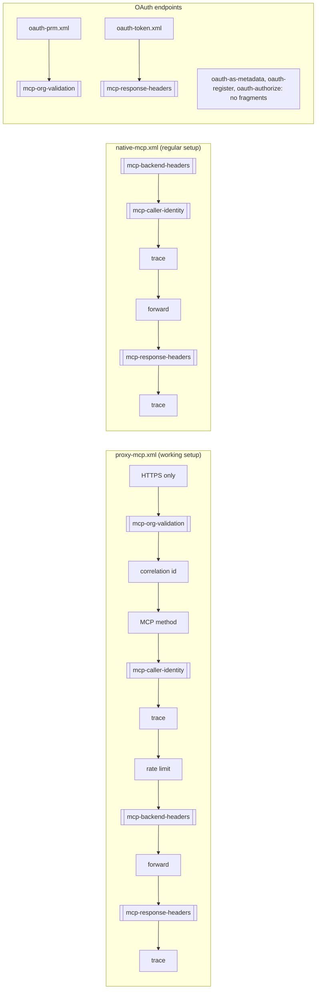

# APIM policies, step by step

This guide walks through every Azure API Management (APIM) policy in
[`infra/policies/`](../infra/policies) in the order a request meets them. It is written for
readers who are new to APIM, OAuth or MCP. Each step says **what** the policy does and
**why**, and what breaks without it.

- Start with the [README](../README.md) for the problem statement and the two sequence
  diagrams. [ANALYSIS.md](ANALYSIS.md) has the root cause and the options.
- [GETTING-STARTED.md](GETTING-STARTED.md) deploys the lab step by step.
- [TESTING.md](TESTING.md) has the end-to-end probe and more test commands.
- [OBSERVABILITY.md](OBSERVABILITY.md) explains the log tables and where each call appears.
- [TOOL-VALIDATION.md](TOOL-VALIDATION.md) explains why no tool arguments are validated, and
  how to add validation if you need it.
- [GLOSSARY.md](GLOSSARY.md) explains the terms (PRM, DCR, PKCE, resource indicator, SSE,
  JSON-RPC, public client, APIM terms and others).
- [CLIENTS-APIM-CHANGES.md](CLIENTS-APIM-CHANGES.md) lists what each MCP client (VS Code,
  OpenAI Codex CLI, Claude Code, GitHub Copilot CLI, MCP Inspector) needs from the gateway;
  [clients/README.md](clients/README.md) has the per-client setup guides.

Every policy file starts with the same comment block (`PURPOSE`, `RUNS ON`, `INPUT`,
`OUTPUT`, `WHY`, `VERIFY`, `FILLED`, `DETAILS`), and short inline comments explain the
non-obvious elements. This document is the long version of those comments. API Management
drops most XML comments when it stores a policy (an earlier version of the lab's proxy policy kept 2 of them), so
read the source files in `infra/policies/`, not the portal's policy editor.

Placeholders used in the samples: `<gateway>` (APIM host name), `<org>` (Azure DevOps
organization), `<tenant-id>` (Entra tenant), `<public-client-id>` (the pre-registered Entra public
client), `<rg>` and `<workspace>` (resource group and Log Analytics workspace).

## Contents

- [How APIM policies work (primer)](#how-apim-policies-work-primer)
- [Policy map](#policy-map)
- [How the policies are composed (fragments)](#how-the-policies-are-composed-fragments)
- Regular setup
  - [1. native-mcp.xml](#1-native-mcpxml-native-mcp-pass-through)
- Working setup
  - [2. proxy-mcp.xml](#2-proxy-mcpxml-the-mcp-data-plane)
  - [3. oauth-prm.xml](#3-oauth-prmxml-protected-resource-metadata)
  - [4. oauth-as-metadata.xml](#4-oauth-as-metadataxml-authorization-server-metadata)
  - [5. oauth-register.xml](#5-oauth-registerxml-dynamic-client-registration-compatibility)
  - [6. oauth-authorize.xml](#6-oauth-authorizexml-authorization-endpoint)
  - [7. oauth-token.xml](#7-oauth-tokenxml-token-endpoint)
- [Shared fragments](#shared-fragments)
- [Changing a policy safely](#changing-a-policy-safely)

## How APIM policies work (primer)

A **policy** is an XML document that APIM runs for every request to an API or operation
(APIM vocabulary: [GLOSSARY.md](GLOSSARY.md#api-management-apim-terms)).
Reference: [API Management policies](https://learn.microsoft.com/azure/api-management/api-management-policies).

**Four sections, in this order:**

| Section | Runs | Typical use here |
|---|---|---|
| `<inbound>` | When the client's request arrives, before anything is sent to a backend | Validate the organization, rewrite OAuth parameters, answer metadata requests directly |
| `<backend>` | When the request is sent to the backend (`<forward-request>`) | `<base />` (the MCP servers forward to their backend); the token endpoint sets a timeout |
| `<outbound>` | When the backend's response comes back, before it goes to the client | Add headers, write telemetry |
| `<on-error>` | When any policy or the backend call fails | Write an error trace, keep correlation headers |

**Scopes and `<base />`.** Policies exist at several scopes: global (All APIs), product,
API and operation. `<base />` means "run the policy of the parent scope here". The two MCP
server policies are **API-level** policies (an MCP server has no operations). The OAuth
policies are **operation-level** policies. Their `<base />` first runs the API-level policy
of the plain API they run in (`ado-mcp-proxy-prm`, `ado-mcp-proxy-oauth` or a discovery
alias), which is a CORS policy (any origin, `GET` and `POST`) defined inline in
`infra/modules/mcp-proxy.bicep`. That is how browser-based
clients such as MCP Inspector get past CORS preflight requests.

**Policy expressions.** Values that start with `@` are C# snippets evaluated per request:

- `@( ... )` is a single expression, for example
  `@(context.Request.Headers.ContainsKey("Authorization"))`.
- `@{ ... }` is a statement block that must `return` a value.
- Inside an XML attribute, quotes and angle brackets must be escaped (`&quot;`, `&lt;`,
  `&gt;`, `&amp;`). That is why the files contain so many `&quot;`.
- `context` gives access to the request (`context.Request.Url`, `.Headers`, `.Body`), the
  response (`context.Response.StatusCode`), the request ID (`context.RequestId`) and the
  variables (`context.Variables`) that `<set-variable>` creates.
- `context.Request.Body.As<string>(preserveContent: true)` reads the request body and keeps
  it, so it can still be forwarded. Reading a **request** body is safe because APIM buffers
  requests. Reading `context.Response.Body` would make APIM buffer the whole **response**,
  which breaks MCP's streamed [SSE](GLOSSARY.md#sse-streamable-http) responses. None of these policies reads it.

**Answering versus forwarding.**

- `<return-response>` stops the pipeline and sends a response built by the policy. No
  backend is called and the `outbound` section does not run. The metadata, register and
  authorize endpoints work this way, and so do the working setup's error answers (`400`,
  `404`).
- `<forward-request>` (usually reached through `<backend><base /></backend>`) sends the
  request to the backend that `<set-backend-service>` or the API selected.

**Fragments.** A policy fragment is a reusable piece of policy XML stored once in APIM and
pulled in with `<include-fragment fragment-id="..." />`
([policy fragments](https://learn.microsoft.com/azure/api-management/policy-fragments)).
Its root element is `<fragment>`; it contains no `<base />` and no section tags, and runs
in whatever section includes it. Fragments are **service-wide**, so they take no per-API
parameters. They read **context variables** that the including policy sets before the
include, and **named values** (`{{name}}`, service-wide settings you can change in the
portal under *Named values* without redeploying). This lab uses four fragments; see
[How the policies are composed](#how-the-policies-are-composed-fragments).

**Where the placeholders come from.** The XML files contain tokens such as `__TENANT_ID__`.
APIM never sees them. Bicep loads each file with `loadTextContent()` and replaces the tokens
before deployment: `infra/modules/mcp-proxy.bicep` uses a small `fill()` function (a
`reduce()` over `replace()`). `native-mcp.xml` has no placeholders. Because the replacement
is plain text, the policy comments refer to placeholders without their underscores ("the
SCOPE placeholder"). Fragments use no placeholders; they read named values instead.

| Placeholder | Filled by | Value |
|---|---|---|
| `TENANT_ID` | `mcp-proxy.bicep` | `tenantId` parameter (or `organizations`) |
| `SCOPE` / `SCOPE_ENC` | `mcp-proxy.bicep` | `https://mcp.dev.azure.com/.default`, plain / URL-encoded |
| `RESOURCE_ENC` | `mcp-proxy.bicep` | `https://mcp.dev.azure.com`, URL-encoded |
| `CLIENT_ID` | `mcp-proxy.bicep` | `publicClientId` parameter (from `scripts/setup-entra.ps1`) |
| `PROXY_PATH` | `mcp-proxy.bicep` | `proxyApiPath` parameter, the working setup's dedicated path (`ado-mcp-proxy`) |
| `OAUTH_PATH` | `mcp-proxy.bicep` | Its OAuth issuer path (`ado-mcp-proxy/oauth`) |
| `RATE_LIMIT_CALLS` / `RATE_LIMIT_PERIOD` | `mcp-proxy.bicep` | `rateLimitCalls` / `rateLimitPeriod` (default 60 calls per 60 s) |

**Named values** (created by `infra/modules/policy-fragments.bicep` from the Bicep
parameters; read by fragments as `{{name}}`). Named values cannot be empty, so `*` means
"no restriction":

| Named value | From parameter | Read by fragment | Value |
|---|---|---|---|
| `mcp-allowed-organizations` | `allowedOrganizations` | `mcp-org-validation` | Comma-separated organizations, or `*` (any well-formed name) |
| `mcp-readonly` | `readOnly` | `mcp-backend-headers` | `true` or `false` |
| `mcp-toolsets` | `toolsets` | `mcp-backend-headers` | Comma-separated toolsets, or `*` (no `X-MCP-Toolsets` header) |

Changing a named value in the portal takes effect at once: `mcp-readonly` and
`mcp-toolsets` for both setups, `mcp-allowed-organizations` for the working setup only (the
regular setup does not include `mcp-org-validation`). The next
deployment resets it to the Bicep parameter, so change the parameter too.

**How `<trace>` reaches Application Insights.** Each API has an `applicationinsights`
diagnostic with verbosity `information`. A `<trace>` whose severity is at least that level
is written as **trace telemetry**: the `<message>` becomes `Message` and every `<metadata>`
becomes a custom property. In the workspace table `AppTraces` you read them as
`Properties["step"]`, `Properties["mcpMethod"]` and so on. Each trace is linked to its
request in `AppRequests` (`AppTraces.ParentId == AppRequests.Id`). Every policy here writes
a `step` value, so one KQL filter shows the whole flow. Reference:
[trace policy](https://learn.microsoft.com/azure/api-management/trace-policy). The tables
(`AppRequests`, `AppTraces`, `ApiManagementGatewayLogs` and others) and what lands in each
are explained in [OBSERVABILITY.md](OBSERVABILITY.md). The MCP servers log an allow-list of
headers; the PRM, OAuth and alias APIs log only the `User-Agent` request header (no bodies,
`code` and `state` masked), which is how [`client-signins.kql`](kql/client-signins.kql)
tells the clients apart.

Run any query in [`docs/kql/`](kql) with:

```powershell
python tools/query_logs.py docs/kql/<file>.kql -g <rg> -w log-<apim-name>
```

Data arrives 2 to 5 minutes after the request.

## Policy map

The regular setup has one policy. The working setup has one MCP server policy and five OAuth
policies, listed in the order a client calls them.

| # | Policy | API / operation | URL (relative to `https://<gateway>`) | When it runs | Trace `step` |
|---|---|---|---|---|---|
| 1 | `native-mcp.xml` | `ado-mcp-native` (type MCP), API level | `/ado-mcp-native/<org>` | Every request of the regular setup | `native-inbound`, `native-outbound` |
| 2 | `proxy-mcp.xml` | `ado-mcp-proxy` (type MCP, an MCP server), API level, no operations | `/ado-mcp-proxy/<org>` and `/ado-mcp-proxy` | First call (gets the 401), then every MCP message | `proxy-inbound`, `proxy-outbound`, `proxy-error` |
| 3 | `oauth-prm.xml` | `ado-mcp-proxy-prm` (path `ado-mcp-proxy/.well-known/oauth-protected-resource`), operations `protected-resource-metadata` (`GET /`) and `protected-resource-metadata-org` (`GET /{org}`); alias API `ado-mcp-proxy-discovery-prm` (same operations) | `/ado-mcp-proxy/.well-known/oauth-protected-resource[/<org>]`; alias `/.well-known/oauth-protected-resource/ado-mcp-proxy[/<org>]` | Right after the 401 | `prm` |
| 4 | `oauth-as-metadata.xml` | `ado-mcp-proxy-oauth`, operations `authorization-server-metadata` and `openid-configuration`; alias APIs `ado-mcp-proxy-discovery-as` and `-oidc` | `/ado-mcp-proxy/oauth/.well-known/oauth-authorization-server` and `/openid-configuration`; aliases `/.well-known/oauth-authorization-server/ado-mcp-proxy/oauth`, `/.well-known/openid-configuration/ado-mcp-proxy/oauth` | After the PRM | `as-metadata` |
| 5 | `oauth-register.xml` | `ado-mcp-proxy-oauth`, operation `register` | `POST /ado-mcp-proxy/oauth/register` | Once per client installation (clients that use DCR) | `register` |
| 6 | `oauth-authorize.xml` | `ado-mcp-proxy-oauth`, operation `authorize` | `GET /ado-mcp-proxy/oauth/authorize` | In the browser, at sign-in | `authorize` |
| 7 | `oauth-token.xml` | `ado-mcp-proxy-oauth`, operation `token` | `POST /ado-mcp-proxy/oauth/token` | After sign-in (code) and on every refresh | `token`, `token-response` |

Nothing is mounted at the gateway root: every working-setup URL starts with
`/ado-mcp-proxy` or is a `/.well-known/...` alias that ends in `/ado-mcp-proxy[...]`
([Isolation](../README.md#isolation-the-working-setup-owns-one-dedicated-path)).

To see all steps of one sign-in in order, run
[`client-signins.kql`](kql/client-signins.kql) (OAuth steps per client) or
[`policy-traces.kql`](kql/policy-traces.kql) (all trace events with their requests).

## How the policies are composed (fragments)

Logic that more than one policy needs lives in a fragment under
`infra/policies/fragments/`, so it is written once and cannot drift between the setups.
Each API policy then reads as a short list of steps. The OAuth endpoint logic itself stays
in its own policy, because each endpoint does one distinct thing.

| Fragment (file) | `native-mcp` | `proxy-mcp` | `oauth-prm` | `oauth-token` | Reads |
|---|---|---|---|---|---|
| `mcp-org-validation` (`org-validation.xml`) | | inbound | inbound | | `{{mcp-allowed-organizations}}`, variable `org-404-body` |
| `mcp-caller-identity` (`caller-identity.xml`) | inbound | inbound | | | `Authorization` header |
| `mcp-backend-headers` (`backend-headers.xml`) | inbound | inbound | | | `{{mcp-readonly}}`, `{{mcp-toolsets}}` |
| `mcp-response-headers` (`response-headers.xml`) | outbound, on-error | outbound, on-error | | outbound | none |



Double-bordered boxes are fragments. Because both MCP servers include the same
`mcp-backend-headers`, the regular and the working setup apply **identical backend
governance** (read-only, toolsets, header hygiene). The working setup adds HTTPS
enforcement, the organization allow-list, a rate limit and a correlation ID. For sign-in,
the difference that matters is the OAuth discovery, which is the point of the comparison.

**Deployment order.** `infra/modules/policy-fragments.bicep` creates the named values, then
the fragments (`dependsOn`), and `main.bicep` deploys the native and proxy modules after it.
APIM rejects a policy that includes a fragment that does not exist yet.

---

## Regular setup

## 1. `native-mcp.xml`: native MCP pass-through

### What it does

This is the policy of APIM's built-in **MCP pass-through** API (APIM's "expose an existing
MCP server" feature). The API forwards every request from `https://<gateway>/ado-mcp-native/<org>`
to `https://mcp.dev.azure.com/<org>`. The policy itself only adds the same governance
headers as the working setup (read-only, toolsets, header hygiene), response headers for
support, and telemetry, all through shared fragments. It reproduces the
customer problem: sign-in through this API fails.

### Why it is needed

The lab needs a faithful copy of the "regular" setup to show what goes wrong. With the
native MCP pass-through, APIM itself (not the policy) changes the OAuth discovery
documents:

1. The origin answers an unauthenticated request with `401` and
   `WWW-Authenticate: Bearer resource_metadata="https://mcp.dev.azure.com/.well-known/oauth-protected-resource/<org>"`.
   APIM rewrites that URL to its own host.
2. APIM proxies the [protected-resource metadata (PRM)](GLOSSARY.md#prm)
   ([RFC 9728](https://datatracker.ietf.org/doc/html/rfc9728)) and rewrites its
   `resource` to the gateway URL. It leaves `authorization_servers` (Entra) and
   `scopes_supported` (`https://mcp.dev.azure.com/.default`) unchanged.
3. The client follows the
   [MCP authorization spec (2025-06-18)](https://modelcontextprotocol.io/specification/2025-06-18/basic/authorization)
   and sends that `resource` to Entra as an
   [resource indicator](GLOSSARY.md#resource-indicator) ([RFC 8707](https://datatracker.ietf.org/doc/html/rfc8707)), together
   with the Azure DevOps scope.
4. Entra rejects the mismatch: `AADSTS9010010: The resource parameter provided in the
   request doesn't match with the requested scopes.`
   ([GLOSSARY.md](GLOSSARY.md#aadsts9010010)).

Clients that need [dynamic client registration (DCR)](GLOSSARY.md#dcr) fail even earlier,
because the authorization server in the PRM is Entra, which has no registration endpoint
(Claude Code and MCP Inspector: *"Incompatible auth server: does not support dynamic
client registration"*). Details per client: [CLIENTS-APIM-CHANGES.md](CLIENTS-APIM-CHANGES.md).

**Limitations of the native MCP API observed in the lab:**

- The rewrite of `resource_metadata` and of the PRM `resource` is built in. No policy
  element can change it.
- The API has **no operations**. `validate-content` needs an operation with a declared
  request representation, so including it made **every** request fail with HTTP 500
  (`OperationNotFound`). Neither MCP server policy includes it
  ([TOOL-VALIDATION.md](TOOL-VALIDATION.md)). The shared fragments contain no
  `validate-content` and work on both MCP servers (verified in the lab).
- In return, MCP servers get MCP-aware logs: the `ApiManagementGatewayMCPLog` table
  ([`mcp-methods.kql`](kql/mcp-methods.kql)) and the `gen_ai.*` dimensions in
  `AppRequests` ([`mcp-calls-app-insights.kql`](kql/mcp-calls-app-insights.kql)), for both
  MCP servers (verified in the lab: `McpServerEndpoint` `/ado-mcp-native` and
  `/ado-mcp-proxy`, with methods, tool names and client names).

Reference: [Expose an existing MCP server in APIM](https://learn.microsoft.com/azure/api-management/expose-existing-mcp-server).

### Step by step

**Inbound**

1. `<base />` runs the global policy first.
2. **Fragment `mcp-backend-headers`**: removes spoofable headers and sets
   `X-MCP-Readonly: true` (when `{{mcp-readonly}}` is `true`) and `X-MCP-Toolsets` (when
   `{{mcp-toolsets}}` is not `*`). The Azure DevOps MCP server then lists and runs only
   those tools. The restriction is enforced by the server, not by APIM.
3. **Fragment `mcp-caller-identity`**: sets `caller-app-id` (the `azp` or `appid` claim)
   and `caller-oid`. The token is decoded only to read those claims; it is not validated
   and never logged.
4. `<trace>` step `native-inbound`: HTTP method, path, `auth=bearer|none`, and
   `clientAppId`.

**Backend**

5. `<base />` forwards to the API's backend (`ado-mcp-origin`). APIM appends the client
   path, so `/ado-mcp-native/<org>` reaches `https://mcp.dev.azure.com/<org>`.

**Outbound**

6. `<base />`.
7. **Fragment `mcp-response-headers`**: `Cache-Control: no-store` and `x-apim-request-id`
   (the APIM request ID, which equals `CorrelationId` in `ApiManagementGatewayLogs`, so a
   user can quote it and you can find the call).
8. `<trace>` step `native-outbound` with the status code. For a `401` the message notes
   that APIM rewrote `resource_metadata`. The policy reads only the status code, never the
   response body, so the SSE stream is not buffered.

**On-error**

9. `<base />` and the same `mcp-response-headers` fragment, so failed calls stay traceable.

### What breaks without it

Nothing in the sign-in. The sign-in is broken by APIM's built-in rewrite whether or not
this policy exists. Without the policy you lose the read-only restriction (the server would
offer its write tools too), the header hygiene and the `native-*` traces.

### Sample request and response

```http
POST https://<gateway>/ado-mcp-native/<org>
Content-Type: application/json
Accept: application/json, text/event-stream

{"jsonrpc":"2.0","id":1,"method":"initialize","params":{"protocolVersion":"2025-06-18","capabilities":{},"clientInfo":{"name":"curl","version":"1"}}}

HTTP/1.1 401 Unauthorized
WWW-Authenticate: Bearer resource_metadata="https://<gateway>/ado-mcp-native/.well-known/oauth-protected-resource/<org>"
Cache-Control: no-store
x-apim-request-id: <request-id>
```

```json
GET https://<gateway>/ado-mcp-native/.well-known/oauth-protected-resource/<org>
{
  "resource": "https://<gateway>/ado-mcp-native/<org>",
  "authorization_servers": [ "https://login.microsoftonline.com/<tenant-id>/v2.0" ],
  "bearer_methods_supported": [ "header" ],
  "scopes_supported": [ "https://mcp.dev.azure.com/.default" ]
}
```

`resource` is the gateway, the scope is Azure DevOps, and the authorization server is
Entra. That combination is what Entra rejects with `AADSTS9010010`.

### How to verify

```powershell
$gw = 'https://<gateway>'
$init = '{"jsonrpc":"2.0","id":1,"method":"initialize","params":{"protocolVersion":"2025-06-18","capabilities":{},"clientInfo":{"name":"curl","version":"1"}}}'
Invoke-WebRequest "$gw/ado-mcp-native/<org>" -Method Post -Body $init -ContentType application/json `
  -Headers @{ Accept = 'application/json, text/event-stream' } -SkipHttpErrorCheck |
  Select-Object StatusCode, @{ n = 'WWW-Authenticate'; e = { $_.Headers['WWW-Authenticate'] } }
# 401, resource_metadata="https://<gateway>/ado-mcp-native/.well-known/oauth-protected-resource/<org>"
Invoke-RestMethod "$gw/ado-mcp-native/.well-known/oauth-protected-resource/<org>" | ConvertTo-Json
# resource = gateway URL, authorization_servers = Entra
```

Logs:

- [`www-authenticate-rewrite.kql`](kql/www-authenticate-rewrite.kql): the origin's
  challenge (`backendChallenge`) next to the one APIM returned (`clientChallenge`).
- [`policy-traces.kql`](kql/policy-traces.kql): steps `native-inbound` / `native-outbound`.
- [`mcp-methods.kql`](kql/mcp-methods.kql): JSON-RPC methods and tools on the native API.

[TESTING.md](TESTING.md#2-curl--powershell-raw-protocol) shows how to reproduce the Entra
rejection without a browser.

---

## Working setup

The working setup uses the same API type as the regular setup, an APIM **MCP server** with
the same backend, and adds five small plain HTTP APIs under its own path that answer OAuth
discovery. The decisive difference: the PRM URL that APIM advertises in the 401 challenge is
answered by the setup's own PRM API, which names the gateway's OAuth facade instead of
Entra. The client then only ever talks to the gateway URL, and the gateway translates the
one value Entra cannot accept (the `resource`) before Entra sees it. The user's own token
still reaches Azure DevOps unchanged.

## 2. `proxy-mcp.xml`: the MCP data plane

### What it does

The policy of the MCP server `ado-mcp-proxy` (APIM → *APIs → MCP servers*, display name
*Azure DevOps MCP (working, ado-mcp-proxy)*). The MCP server forwards MCP traffic from
`https://<gateway>/ado-mcp-proxy/<org>` to `https://mcp.dev.azure.com/<org>` (backend
`ado-mcp-origin`) and streams the response. The policy only governs the edge:

- checks HTTPS and the organization name (allow-list);
- sets a correlation ID and records the MCP method and the caller for telemetry;
- rate-limits per client IP (behind a reverse proxy: the IP the proxy appended to
  `X-Forwarded-For`, or optionally per user);
- sets the server-side tool restriction headers `X-MCP-Readonly` and `X-MCP-Toolsets`, and
  removes request headers a client could spoof;
- adds response headers for support.

The caller's Entra token is forwarded **unchanged**, so Azure DevOps authorizes and audits
the signed-in user. The policy has no `<forward-request>` of its own, does not rewrite the
`401` challenge and does not validate tool arguments.

`https://<gateway>/ado-mcp-proxy` without an organization is the "bare" endpoint; Azure
DevOps tools then need an `orgName` argument. One deployment serves many organizations.
[CLIENTS-APIM-CHANGES.md](CLIENTS-APIM-CHANGES.md) explains how each client uses this URL.

### Why it is needed

- **Governance at the edge**: organization allow-list, rate limit, header hygiene,
  correlation and telemetry, without touching the user's identity. The regular setup shares
  the header-hygiene, read-only/toolsets and telemetry fragments, but not the allow-list,
  rate limit, HTTPS check or correlation ID.
- **Discovery is handled outside this policy.** Under
  [MCP authorization](https://modelcontextprotocol.io/specification/2025-06-18/basic/authorization),
  a `401` carries `WWW-Authenticate: Bearer resource_metadata="..."`. The MCP server
  generates it, as on the regular setup:
  `resource_metadata="https://<gateway>/ado-mcp-proxy/.well-known/oauth-protected-resource/<org>"`
  (bare endpoint: `.../oauth-protected-resource/`). The plain API `ado-mcp-proxy-prm`
  answers that URL (section 3), because API Management routes to the most specific API
  path. That is what makes sign-in work. The challenge carries no `scope` parameter;
  `/authorize` and `/token` add the scope when a client sends none (sections 6 and 7).
- **Streaming must stay intact.** The
  [Streamable HTTP transport](https://modelcontextprotocol.io/specification/2025-06-18/basic/transports)
  answers a POST with `text/event-stream`. The policy never reads the response body.

### Step by step

**Inbound**

1. `<base />` runs the global policy.
2. **HTTPS check.** `choose` / `when Scheme != "https"` returns `400 HTTPS Required`.
   A bearer token must never travel unencrypted. The API only lists the `https` protocol,
   so this is defence in depth.
3. **Organization (fragment `mcp-org-validation`).** The policy first sets
   `org-404-body` to `json`, then includes the fragment. An MCP server has no URL template,
   so the fragment reads the path after the API path (`context.Api.Path`) into the variable
   `org` (empty on the bare endpoint). If `org` is set and does not match
   `^[A-Za-z0-9][A-Za-z0-9_-]{0,49}$`, or `{{mcp-allowed-organizations}}` is not `*` and
   does not contain it (case-insensitive), it returns `404 {"error":"unknown_organization"}`.
   The regular expression blocks path tricks; the allow-list keeps the gateway from serving
   organizations you did not intend.
4. **`set-variable correlation-id`**: a caller-supplied `X-Correlation-ID` is reused only if
   it is a GUID (this prevents log injection); otherwise the APIM request ID is used.
5. **`set-variable mcp-method`**: the [JSON-RPC](GLOSSARY.md#json-rpc) `method` from the request body
   (`initialize`, `tools/call`, ...), for telemetry only. Requests without a body (GET or
   DELETE probes) or with a non-JSON body fall back to the HTTP method, and a JSON-RPC
   *response* sent by the client shows as `(response)`.
6. **Fragment `mcp-caller-identity`**, then **`<trace>` step `proxy-inbound`**: MCP method,
   organization, `auth=bearer|none`, correlation ID, the user's object ID (`caller-oid`) and
   the client app ID (`caller-app-id`). The token is decoded only to read these claims; it
   is not validated here and never logged.
7. **`set-variable client-ip`, `rate-limit-by-key`**: at most `RATE_LIMIT_CALLS` calls per
   `RATE_LIMIT_PERIOD` seconds per client IP, then `429` with `Retry-After`. This protects
   the backend and the user's Azure DevOps request budget. The client IP is the TCP peer;
   when `{{mcp-trust-forwarded-for}}` is `true` (behind Application Gateway) it is the
   **last** `X-Forwarded-For` entry without the port, the one the proxy appended, so
   clients cannot forge it. With `{{mcp-rate-limit-key}}` = `user` the key is the token's
   `oid` (client IP without a token); the token is not validated here, so pair that with
   `validate-azure-ad-token` ([APP-GATEWAY.md](APP-GATEWAY.md#8-rate-limiting-behind-a-proxy)).
8. **Fragment `mcp-backend-headers`**: `X-MCP-Readonly: true` when `{{mcp-readonly}}` is
   `true`, and `X-MCP-Toolsets: <list>` when `{{mcp-toolsets}}` is not `*` (the server then
   only offers those tool groups). Before that it deletes `Forwarded`, `X-Forwarded-*`,
   `X-Original-Host`, `X-Original-URL`, `X-Rewrite-URL`, `Proxy-Authorization`,
   `Proxy-Connection`, the App Service identity headers `X-MS-CLIENT-PRINCIPAL*` and
   `X-MS-TOKEN-AAD-ACCESS-TOKEN`, and APIM's own `Ocp-Apim-Trace*`. Clients could otherwise
   make the backend believe things APIM never checked.
9. **`X-Correlation-ID`** is set on the backend request.

**Backend**

10. `<base />`: the MCP server forwards to its backend `ado-mcp-origin` (the bare host
    `https://mcp.dev.azure.com`) and appends the rest of the client path (`/<org>`), so one
    backend serves every organization. The response streams back without buffering.

**Outbound**

11. `<base />`.
12. **Fragment `mcp-response-headers`**: `Cache-Control: no-store` (MCP responses are per
    user) and `x-apim-request-id`.
13. **`X-Correlation-ID`** goes back to the client for support.
14. **`<trace>` step `proxy-outbound`** with status code and correlation ID. Only the status
    code is read, never `context.Response.Body` (that would buffer SSE).

**On-error**

15. `<base />`, then `<trace>` step `proxy-error` (severity error) with `LastError.Reason`,
    `Message` and `Source` (the policy that failed).
16. The same `mcp-response-headers` fragment and `X-Correlation-ID` header.
    `GetValueOrDefault` is used because the error can occur before `correlation-id` was set.

### What breaks without it

Sign-in does not depend on this policy: the challenge comes from the MCP server and the
PRM from section 3. Without the policy you lose:

- **the organization check**: any path segment reaches Azure DevOps, including mistakes such
  as `/mcp` (the server treats it as an organization named `mcp` and fails with `VS30063`,
  see [`backend-url-mapping.kql`](kql/backend-url-mapping.kql));
- **`mcp-backend-headers`**: the server offers its write tools as well, and a client can
  inject forwarding or identity headers that the backend might trust;
- the rate limit, the correlation ID and the `proxy-*` traces.

Reading `context.Response.Body` anywhere in this policy would make APIM hold all SSE events
until the stream ends. Clients would see no progress and long calls would time out.

**No tool argument validation.** `validate-content` needs API operations, and an MCP server
has none: including it made every request fail with HTTP 500. The hosted server therefore
receives `tools/call` arguments unchanged. Options to add validation are in
[TOOL-VALIDATION.md](TOOL-VALIDATION.md).

### Sample request and response

Unauthenticated first call:

```http
POST https://<gateway>/ado-mcp-proxy/<org>
Content-Type: application/json
Accept: application/json, text/event-stream

{"jsonrpc":"2.0","id":1,"method":"initialize","params":{"protocolVersion":"2025-06-18","capabilities":{},"clientInfo":{"name":"curl","version":"1"}}}

HTTP/1.1 401 Unauthorized
WWW-Authenticate: Bearer resource_metadata="https://<gateway>/ado-mcp-proxy/.well-known/oauth-protected-resource/<org>"
```

After sign-in:

```http
POST https://<gateway>/ado-mcp-proxy/<org>
Authorization: Bearer <access-token>
Content-Type: application/json
Accept: application/json, text/event-stream

{"jsonrpc":"2.0","id":3,"method":"tools/call","params":{"name":"core_list_projects","arguments":{"top":5}}}

HTTP/1.1 200 OK
Content-Type: text/event-stream
Cache-Control: no-store

event: message
data: {"result":{"content":[{"type":"text","text":"[{\"name\":\"<project>\",...}]"}]},"id":3,"jsonrpc":"2.0"}
```

Unknown or malformed organization:

```http
POST https://<gateway>/ado-mcp-proxy/not.an.org
HTTP/1.1 404 Not Found
Content-Type: application/json

{"error":"unknown_organization"}
```

### How to verify

```powershell
$gw = 'https://<gateway>'
$init = '{"jsonrpc":"2.0","id":1,"method":"initialize","params":{"protocolVersion":"2025-06-18","capabilities":{},"clientInfo":{"name":"curl","version":"1"}}}'
$h = @{ Accept = 'application/json, text/event-stream' }

# 401 whose resource_metadata names /ado-mcp-proxy/.well-known/oauth-protected-resource/<org>
Invoke-WebRequest "$gw/ado-mcp-proxy/<org>" -Method Post -Body $init -ContentType application/json -Headers $h -SkipHttpErrorCheck |
  Select-Object StatusCode, @{ n = 'WWW-Authenticate'; e = { $_.Headers['WWW-Authenticate'] } }

# 404 for a malformed organization name
(Invoke-WebRequest "$gw/ado-mcp-proxy/not.an.org" -Method Post -Body $init -ContentType application/json -Headers $h -SkipHttpErrorCheck).StatusCode

# With a token: SSE answer from Azure DevOps
$h.Authorization = 'Bearer ' + (az account get-access-token --scope https://mcp.dev.azure.com/.default --query accessToken -o tsv)
(Invoke-WebRequest "$gw/ado-mcp-proxy/<org>" -Method Post -Body $init -ContentType application/json -Headers $h).Content
# event: message / data: {...serverInfo...}
```

Logs:

- [`policy-traces.kql`](kql/policy-traces.kql): `proxy-inbound` / `proxy-outbound` with
  MCP method, organization, user `oid` and client app ID.
- [`errors.kql`](kql/errors.kql): failures with the pipeline stage that raised them.
- [`auth-summary.kql`](kql/auth-summary.kql): requests per API, auth type and status.

---

## 3. `oauth-prm.xml`: protected-resource metadata

### What it does

Runs on the plain API `ado-mcp-proxy-prm` (path
`ado-mcp-proxy/.well-known/oauth-protected-resource`) and on the alias API
`ado-mcp-proxy-discovery-prm`. It answers
`GET /ado-mcp-proxy/.well-known/oauth-protected-resource/<org>` (the URL the MCP server's
401 challenge names) and the alias
`GET /.well-known/oauth-protected-resource/ado-mcp-proxy/<org>` (and both variants without
`<org>`) directly from APIM with a PRM document:

- `resource` = the URL the client connects to (`https://<gateway>/ado-mcp-proxy/<org>`);
- `authorization_servers` = the gateway's OAuth facade (`https://<gateway>/ado-mcp-proxy/oauth`), not Entra;
- `scopes_supported` = `https://mcp.dev.azure.com/.default`.

### Why it is needed

- **It replaces APIM's built-in metadata.** The MCP server would answer the URL in its
  challenge with APIM's own PRM, which names Entra as authorization server (the regular
  setup's failure). API Management routes to the most specific API path, so the API
  `ado-mcp-proxy-prm` at `/ado-mcp-proxy/.well-known/oauth-protected-resource` takes
  precedence over the MCP server at `/ado-mcp-proxy` (verified in the lab). This is the fix.
- [RFC 9728 section 3.3](https://datatracker.ietf.org/doc/html/rfc9728#section-3.3): the
  `resource` in the metadata must be identical to the resource identifier used to build the
  metadata URL. VS Code enforces this and rejects metadata for another URL.
- [MCP authorization](https://modelcontextprotocol.io/specification/2025-06-18/basic/authorization):
  clients send this `resource` as the
  [RFC 8707](https://datatracker.ietf.org/doc/html/rfc8707) `resource` parameter. If the
  authorization server were Entra, Entra would receive the gateway URL and fail with
  `AADSTS9010010`. Naming the **gateway** as authorization server sends the client to
  APIM's `authorize` and `token`, which translate the resource first. The issuer has a
  path (`/ado-mcp-proxy/oauth`), so the gateway root stays free for other APIs.
- The alias follows RFC 9728 path insertion (`/.well-known/oauth-protected-resource` +
  resource path). Clients that ignore the challenge and probe the well-known URL themselves
  (OpenAI Codex does) land there. The alias API's path ends in `/ado-mcp-proxy`, so it
  answers only for this setup.
- [CLIENTS-APIM-CHANGES.md](CLIENTS-APIM-CHANGES.md) lists how each client fetches the PRM.

### Step by step

1. `<base />` runs the API-level CORS policy.
2. **Fragment `mcp-org-validation`** (the same one the MCP server policy includes, without
   `org-404-body`): sets `org` from the `{org}` template parameter (empty for the variant
   without it) and answers an empty `404` for an organization that fails the regular
   expression or `{{mcp-allowed-organizations}}`. APIM never advertises metadata for an
   organization the MCP server policy would reject.
3. **`<trace>` step `prm`** with the organization.
4. **`<return-response>`** `200`:
   - `resource` = request scheme + host + `/` + `PROXY_PATH` (+ `/` + organization when the
     URL has one). Both URL shapes (challenge URL and alias) give the same document. The
     host comes from the request, so custom domains work. When
     `{{mcp-trust-forwarded-for}}` is `true`, a well-formed last `X-Forwarded-Host` entry
     replaces it (a proxy that sends APIM another host,
     [APP-GATEWAY.md](APP-GATEWAY.md#9-second-host-custom-domain-only-on-application-gateway)); the same
     rule applies to the issuer in `oauth-as-metadata.xml`.
   - `authorization_servers` = `[ scheme + host + "/" + OAUTH_PATH ]`.
   - `bearer_methods_supported` = `["header"]`, `scopes_supported` = `[SCOPE]`,
     `resource_name` for display.
   - `Access-Control-Allow-Origin: *` so browser clients can read it; `Cache-Control: no-store`
     so a stale copy is never reused after a change.

No backend is called, so `<backend>` and `<outbound>` do not run.

### What breaks without it

The URL in the MCP server's challenge would be answered by APIM's built-in metadata, which
names Entra as authorization server. Sign-in then fails exactly as on the regular setup:
`AADSTS9010010`, or *"does not support dynamic client registration"* for DCR clients.
Without the alias, OpenAI Codex (which ignores the challenge) finds no PRM.

### Sample request and response

```json
GET https://<gateway>/ado-mcp-proxy/.well-known/oauth-protected-resource/<org>

200 OK
{
  "resource": "https://<gateway>/ado-mcp-proxy/<org>",
  "authorization_servers": [ "https://<gateway>/ado-mcp-proxy/oauth" ],
  "bearer_methods_supported": [ "header" ],
  "scopes_supported": [ "https://mcp.dev.azure.com/.default" ],
  "resource_name": "Azure DevOps MCP via API Management"
}
```

### How to verify

```powershell
Invoke-RestMethod 'https://<gateway>/ado-mcp-proxy/.well-known/oauth-protected-resource/<org>' | ConvertTo-Json
Invoke-RestMethod 'https://<gateway>/.well-known/oauth-protected-resource/ado-mcp-proxy/<org>' | ConvertTo-Json   # alias, same document
# resource = https://<gateway>/ado-mcp-proxy/<org>, authorization_servers = https://<gateway>/ado-mcp-proxy/oauth
```

Logs: step `prm` in [`policy-traces.kql`](kql/policy-traces.kql) and
[`client-signins.kql`](kql/client-signins.kql).

---

## 4. `oauth-as-metadata.xml`: authorization-server metadata

### What it does

Answers the authorization-server metadata URLs of the issuer
`https://<gateway>/ado-mcp-proxy/oauth`: path-appended
(`/ado-mcp-proxy/oauth/.well-known/oauth-authorization-server` and
`/ado-mcp-proxy/oauth/.well-known/openid-configuration`) and path-inserted aliases
(`/.well-known/oauth-authorization-server/ado-mcp-proxy/oauth`,
`/.well-known/openid-configuration/ado-mcp-proxy/oauth`). The document names that issuer
and lists the gateway's own `authorize`, `token` and `register` under it.

### Why it is needed

- The PRM names `https://<gateway>/ado-mcp-proxy/oauth` as authorization server, so the
  client fetches this document next ([RFC 8414](https://datatracker.ietf.org/doc/html/rfc8414)).
  For an issuer with a path, clients try the path-inserted OAuth URL, then OpenID variants.
  All three CLIs used the path-inserted alias in the lab; Codex and Claude Code failed when
  it was missing, so the aliases are required.
- [RFC 8414 section 3.3](https://datatracker.ietf.org/doc/html/rfc8414#section-3.3): the
  `issuer` must equal the identifier the client used to build the metadata URL. The policy
  derives it from the request, so it matches on the default host and on custom domains.
- [MCP authorization](https://modelcontextprotocol.io/specification/2025-06-18/basic/authorization)
  requires PKCE, and the
  [2025-11-25 revision](https://modelcontextprotocol.io/specification/2025-11-25/basic/authorization)
  tells clients to refuse an authorization server whose metadata does not list
  `code_challenge_methods_supported`. The document advertises `S256`.
- `registration_endpoint` lets [DCR](GLOSSARY.md#dcr) clients continue (section 5).

### Step by step

1. `<base />` runs the API-level CORS policy.
2. **`<trace>` step `as-metadata`** with the path that was requested.
3. **`<return-response>`** `200` with:
   - `issuer` = request scheme + host + `/` + `OAUTH_PATH` (`/ado-mcp-proxy/oauth`);
   - `authorization_endpoint` = `issuer/authorize`, `token_endpoint` = `issuer/token`,
     `registration_endpoint` = `issuer/register`;
   - `response_types_supported` = `["code"]`, `grant_types_supported` =
     `["authorization_code","refresh_token"]`;
   - `code_challenge_methods_supported` = `["S256"]` ([PKCE](GLOSSARY.md#authorization-code-flow-pkce),
     [RFC 7636](https://datatracker.ietf.org/doc/html/rfc7636));
   - `token_endpoint_auth_methods_supported` = `["none"]`: a [public client](GLOSSARY.md#entra-public-client)
     without a secret;
   - `scopes_supported` = `[SCOPE]`;
   - `Access-Control-Allow-Origin: *`, `Cache-Control: no-store`.

### What breaks without it

The client finds no authorize or token endpoint and stops after the PRM. With a wrong
`issuer` the client rejects the metadata. Without `S256` clients that follow 2025-11-25
refuse to continue. Without `registration_endpoint` DCR clients fail with *"does not
support dynamic client registration"*.

### Sample request and response

```json
GET https://<gateway>/.well-known/oauth-authorization-server/ado-mcp-proxy/oauth

200 OK
{
  "issuer": "https://<gateway>/ado-mcp-proxy/oauth",
  "authorization_endpoint": "https://<gateway>/ado-mcp-proxy/oauth/authorize",
  "token_endpoint": "https://<gateway>/ado-mcp-proxy/oauth/token",
  "registration_endpoint": "https://<gateway>/ado-mcp-proxy/oauth/register",
  "response_types_supported": [ "code" ],
  "grant_types_supported": [ "authorization_code", "refresh_token" ],
  "code_challenge_methods_supported": [ "S256" ],
  "token_endpoint_auth_methods_supported": [ "none" ],
  "scopes_supported": [ "https://mcp.dev.azure.com/.default" ]
}
```

### How to verify

```powershell
Invoke-RestMethod 'https://<gateway>/.well-known/oauth-authorization-server/ado-mcp-proxy/oauth' | ConvertTo-Json
Invoke-RestMethod 'https://<gateway>/ado-mcp-proxy/oauth/.well-known/openid-configuration' | ConvertTo-Json   # same document
```

Logs: step `as-metadata` in [`policy-traces.kql`](kql/policy-traces.kql) and
[`client-signins.kql`](kql/client-signins.kql).

---

## 5. `oauth-register.xml`: dynamic client registration compatibility

### What it does

Answers `POST /register` ([RFC 7591](https://datatracker.ietf.org/doc/html/rfc7591)) with
**one pre-registered Entra public client ID** (`CLIENT_ID`, created by
`scripts/setup-entra.ps1`) for every MCP client. It echoes the redirect URIs the client
asked for and issues no secret.

### Why it is needed

- Clients without a configured client ID register dynamically, as
  [MCP authorization](https://modelcontextprotocol.io/specification/2025-06-18/basic/authorization)
  recommends. In the lab: OpenAI Codex CLI (`client_name` "Codex"), Claude Code, GitHub
  Copilot CLI, VS Code and MCP Inspector.
- Microsoft Entra has no registration endpoint. Without this operation, those clients stop
  with *"Incompatible auth server: does not support dynamic client registration"*.
- Entra still enforces the **[redirect URIs](GLOSSARY.md#redirect-uri) registered on the app**. The gateway echoes
  whatever the client sends, but sign-in only succeeds if Entra knows that redirect URI.
  For loopback URIs (`http://127.0.0.1`, `http://localhost`) Entra ignores the port but
  checks the path, so each client's path must be registered. The observed redirects are:
  - VS Code: `http://127.0.0.1:33418/`
  - OpenAI Codex CLI: `http://127.0.0.1:<port>/callback/<id derived from the MCP URL>`
  - Claude Code: `http://localhost:<port>/callback`
  - GitHub Copilot CLI: `http://127.0.0.1:<port>/`

  [CLIENTS-APIM-CHANGES.md](CLIENTS-APIM-CHANGES.md) explains which URIs to add for each
  client.

### Step by step

1. `<base />` runs the API-level CORS policy (MCP Inspector registers from the browser).
2. **`set-variable dcr-request`** parses the JSON body once. An empty or invalid body gives
   an empty object, so the client still gets the static answer instead of HTTP 500.
3. **`<trace>` step `register`** with `clientName` (truncated to 80 characters) and the
   requested `redirectUris`. A registration request contains nothing secret, and this is
   the quickest way to see which redirect URI a new client needs.
4. **`<return-response>`** `201 Created` (RFC 7591 section 3.2.1):
   - `client_id` = `CLIENT_ID`, `client_id_issued_at` = now;
   - `client_name` echoed (default "MCP client");
   - `redirect_uris` echoed, or VS Code's defaults when the client sent none (clients check
     the returned list against what they sent);
   - `application_type` `native`, `grant_types` `authorization_code` + `refresh_token`,
     `response_types` `code`, `token_endpoint_auth_method` `none`;
   - `Access-Control-Allow-Origin: *`, `Cache-Control: no-store`.

### What breaks without it

DCR clients stop before sign-in (*"does not support dynamic client registration"*). If a
client's redirect URI is missing on the Entra app, registration succeeds here but Entra
later fails with `AADSTS50011` (redirect URI mismatch).

### Sample request and response

```http
POST https://<gateway>/ado-mcp-proxy/oauth/register
Content-Type: application/json

{"client_name":"Claude Code","redirect_uris":["http://localhost:<port>/callback"],
 "grant_types":["authorization_code","refresh_token"],"response_types":["code"],"token_endpoint_auth_method":"none"}

HTTP/1.1 201 Created
Content-Type: application/json
Cache-Control: no-store

{
  "client_id": "<public-client-id>",
  "client_id_issued_at": 1763400000,
  "client_name": "Claude Code",
  "application_type": "native",
  "redirect_uris": [ "http://localhost:<port>/callback" ],
  "grant_types": [ "authorization_code", "refresh_token" ],
  "response_types": [ "code" ],
  "token_endpoint_auth_method": "none"
}
```

### How to verify

```powershell
Invoke-RestMethod 'https://<gateway>/ado-mcp-proxy/oauth/register' -Method Post -ContentType application/json `
  -Body '{"client_name":"policy-test","redirect_uris":["http://127.0.0.1:12345/"]}' | ConvertTo-Json
# client_id = <public-client-id>, redirect_uris echoed, token_endpoint_auth_method = none
```

Logs: [`client-signins.kql`](kql/client-signins.kql) shows `register` with `clientName` and
`redirectUris` per client, identified by its `User-Agent`. Replace `<client>` in the query
with part of a User-Agent (for example `codex`, `claude`, `copilot`, `vscode`) to see one
client.

---

## 6. `oauth-authorize.xml`: authorization endpoint

### What it does

Answers `GET /authorize` (opened in the user's browser) with a `302` redirect to the Entra
v2 authorize endpoint of `TENANT_ID`. It keeps the client's query parameters, removes the
client's `resource`, adds `resource=https://mcp.dev.azure.com`, adds the Azure DevOps scope
if the client sent none, and requires PKCE `S256`.

### Why it is needed

- The client sends `resource=https://<gateway>/ado-mcp-proxy/<org>` (from the PRM), as
  [RFC 8707](https://datatracker.ietf.org/doc/html/rfc8707) and MCP authorization require.
  Entra accepts as `resource` only an identifier of the app that owns the requested scope.
  The gateway URL is not one, so Entra would fail with `AADSTS9010010`. The policy swaps in
  `https://mcp.dev.azure.com`, which Entra accepts for the scope
  `https://mcp.dev.azure.com/.default`.
- [PKCE (RFC 7636)](https://datatracker.ietf.org/doc/html/rfc7636) is mandatory in MCP
  authorization. The client is a public client without a secret, so PKCE is what stops an
  intercepted authorization code from being redeemed by someone else.
- Observed clients (Codex, Claude Code, Copilot CLI, VS Code) all send `resource`;
  [CLIENTS-APIM-CHANGES.md](CLIENTS-APIM-CHANGES.md) has the details.

### Step by step

1. `<base />` runs the API-level CORS policy.
2. **PKCE check**: if `code_challenge` is missing or `code_challenge_method` is not
   `S256`, the policy returns `400 {"error":"invalid_request","error_description":"PKCE with code_challenge_method=S256 is required."}`.
   Entra is never contacted.
3. **`<trace>` step `authorize`** with `clientId`, `redirectUri` and `clientResource` (the
   resource the client asked for). `code_challenge` and `state` are not logged, and the
   API's diagnostic setting masks `code` and `state` in request URLs.
4. **`<return-response>`** `302 Found` with a `Location` built from the **raw** query
   string:
   - split on `&`, drop every `resource=` part, keep the others byte for byte (no decoding
     and re-encoding, so every value keeps the client's encoding);
   - append `scope=SCOPE_ENC` only if no `scope=` part exists;
   - append `resource=RESOURCE_ENC` (`https%3A%2F%2Fmcp.dev.azure.com`);
   - prefix `https://login.microsoftonline.com/TENANT_ID/oauth2/v2.0/authorize?`.

   `Cache-Control: no-store` keeps the redirect out of caches.

Entra then checks `client_id`, `redirect_uri` and consent as usual and redirects the browser
to the client's redirect URI with the code. APIM is not involved in that step.

### What breaks without it

Entra receives the gateway URL as resource and answers
`error=invalid_target`, `AADSTS9010010: The resource parameter provided in the request
doesn't match with the requested scopes.` No sign-in page is shown.

### Sample request and response

```http
GET https://<gateway>/ado-mcp-proxy/oauth/authorize?client_id=<public-client-id>&response_type=code
    &redirect_uri=http%3A%2F%2F127.0.0.1%3A33418%2F&state=<state>
    &code_challenge=<challenge>&code_challenge_method=S256
    &scope=https%3A%2F%2Fmcp.dev.azure.com%2F.default
    &resource=https%3A%2F%2F<gateway>%2Fado-mcp-proxy%2F<org>

HTTP/1.1 302 Found
Location: https://login.microsoftonline.com/<tenant-id>/oauth2/v2.0/authorize?client_id=<public-client-id>&response_type=code
  &redirect_uri=http%3A%2F%2F127.0.0.1%3A33418%2F&state=<state>&code_challenge=<challenge>&code_challenge_method=S256
  &scope=https%3A%2F%2Fmcp.dev.azure.com%2F.default&resource=https%3A%2F%2Fmcp.dev.azure.com
Cache-Control: no-store
```

### How to verify

```powershell
$gw = 'https://<gateway>'
$q = 'client_id=<public-client-id>&response_type=code&redirect_uri=http%3A%2F%2F127.0.0.1%3A33418%2F&state=x' +
     '&code_challenge=E9Melhoa2OwvFrEMTJguCHaoeK1t8URWbuGJSstw-cM&code_challenge_method=S256' +
     '&resource=' + [uri]::EscapeDataString("$gw/ado-mcp-proxy/<org>")
$r = Invoke-WebRequest "$gw/ado-mcp-proxy/oauth/authorize?$q" -MaximumRedirection 0 -SkipHttpErrorCheck -ErrorAction SilentlyContinue
$r.StatusCode                 # 302
$r.Headers.Location           # ...&scope=https%3A%2F%2Fmcp.dev.azure.com%2F.default&resource=https%3A%2F%2Fmcp.dev.azure.com

# Without PKCE: 400 invalid_request
(Invoke-WebRequest "$gw/ado-mcp-proxy/oauth/authorize?client_id=<public-client-id>&response_type=code" -SkipHttpErrorCheck).StatusCode
```

Open the `Location` URL in a browser: Entra shows the sign-in page instead of
`AADSTS9010010`. Logs: [`client-signins.kql`](kql/client-signins.kql) shows `authorize` with
`clientResource` (what the client asked for) and `redirect`.

---

## 7. `oauth-token.xml`: token endpoint

### What it does

Forwards `POST /token` to the Entra v2 token endpoint of `TENANT_ID`, with the same
`resource` translation as `/authorize` and the scope added if missing. It removes the
`Origin` header and returns Entra's response unchanged. It handles both the code exchange
(`grant_type=authorization_code`) and refreshes (`grant_type=refresh_token`).

### Why it is needed

- RFC 8707 and MCP authorization make the client repeat `resource` in the token request.
  Entra would reject the gateway URL here exactly as at `/authorize`.
- A browser-based client (MCP Inspector) sends an `Origin` header. Entra allows
  cross-origin token redemption only for apps registered as single-page applications and
  otherwise fails with `AADSTS9002326` (documented Entra behaviour; not reproduced in this lab,
  because it needs a real authorization code). The pre-registered client is a native public client,
  so the gateway removes `Origin` and the call becomes a server-to-server call.
- Tokens must never be logged or cached
  ([RFC 6749 section 5.1](https://datatracker.ietf.org/doc/html/rfc6749#section-5.1)).
- [CLIENTS-APIM-CHANGES.md](CLIENTS-APIM-CHANGES.md) notes how each client refreshes.

### Step by step

**Inbound**

1. `<base />` runs the API-level CORS policy.
2. **`set-variable form`** reads the form body as raw text (`preserveContent: false`, it is
   replaced next), splits it on `&`, drops every `resource=` part, appends
   `scope=SCOPE_ENC` if no scope was sent, and appends `resource=RESOURCE_ENC`. All other
   fields (`grant_type`, `code`, `code_verifier`, `redirect_uri`, `client_id`,
   `refresh_token`) are kept byte for byte. An empty body becomes an empty form, and Entra
   answers with its own error.
3. **`<set-body>`** replaces the request body with the rewritten form.
4. **`<trace>` step `token`** with the `grant_type` only. Codes, verifiers and refresh
   tokens are never logged.
5. **`Content-Type: application/x-www-form-urlencoded`**: the only format Entra's token
   endpoint accepts.
6. **Delete `Origin`** (see above).
7. **`set-backend-service`** `https://login.microsoftonline.com/TENANT_ID/oauth2/v2.0` and
   **`rewrite-uri`** `/token` (client query parameters are not copied).

**Backend**

8. `<forward-request timeout="30" />` calls Entra.

**Outbound**

9. `<base />`, then **`<trace>` step `token-response`** with the status code only. The body
   contains tokens and is neither read nor logged; the API's diagnostic setting logs no
   bodies or headers apart from `User-Agent`.
10. **Fragment `mcp-response-headers`** (`Cache-Control: no-store`, `x-apim-request-id`),
    **delete `Set-Cookie`** (Entra session cookies belong to
    the Entra host, not the gateway), **`Access-Control-Allow-Origin: *`** so browser
    clients can read the response.

### What breaks without it

The client cannot redeem its code (Entra would reject the gateway URL as resource, again
`invalid_target`; expected, not tested in this lab), or, for browser clients, fails with
`AADSTS9002326` (documented, not reproduced). Refreshes fail the
same way, so users would have to sign in again whenever the access token expires.

### Sample request and response

```http
POST https://<gateway>/ado-mcp-proxy/oauth/token
Content-Type: application/x-www-form-urlencoded

grant_type=authorization_code&client_id=<public-client-id>&code=<code>&code_verifier=<verifier>
&redirect_uri=http%3A%2F%2F127.0.0.1%3A33418%2F&resource=https%3A%2F%2F<gateway>%2Fado-mcp-proxy%2F<org>
```

Forwarded to Entra as:

```http
POST https://login.microsoftonline.com/<tenant-id>/oauth2/v2.0/token
Content-Type: application/x-www-form-urlencoded

grant_type=authorization_code&client_id=<public-client-id>&code=<code>&code_verifier=<verifier>
&redirect_uri=http%3A%2F%2F127.0.0.1%3A33418%2F&scope=https%3A%2F%2Fmcp.dev.azure.com%2F.default
&resource=https%3A%2F%2Fmcp.dev.azure.com
```

Response (returned unchanged, values shortened):

```json
HTTP/1.1 200 OK
Cache-Control: no-store

{ "token_type": "Bearer", "scope": "<granted Azure DevOps MCP scope>", "expires_in": 3599,
  "access_token": "<access-token>", "refresh_token": "<refresh-token>" }
```

### How to verify

A complete exchange needs a real code (run the probe or a client, see
[TESTING.md](TESTING.md#3-real-mcp-clients-vs-code-copilot-cli-codex-claude-code-mcp-inspector)). A quick check that the policy forwards to Entra:

```powershell
$gw = 'https://<gateway>'
$form = 'grant_type=authorization_code&client_id=<public-client-id>&code=invalid&code_verifier=x' +
        '&redirect_uri=http%3A%2F%2F127.0.0.1%3A33418%2F&resource=' + [uri]::EscapeDataString("$gw/ado-mcp-proxy/<org>")
$r = Invoke-WebRequest "$gw/ado-mcp-proxy/oauth/token" -Method Post -ContentType 'application/x-www-form-urlencoded' -Body $form -SkipHttpErrorCheck
$r.StatusCode; $r.Content
# 400 with an Entra error JSON (for example invalid_grant for the fake code), not invalid_target / AADSTS9010010
```

Logs: steps `token` and `token-response` in [`client-signins.kql`](kql/client-signins.kql)
(per client, by `User-Agent`) and [`policy-traces.kql`](kql/policy-traces.kql). The next
MCP call shows the token's client app ID (`clientAppId`) in `proxy-inbound`, which proves
the client really uses the pre-registered public client.

---

## Shared fragments

Each fragment lives in `infra/policies/fragments/` and is deployed by
`infra/modules/policy-fragments.bicep`. A fragment talks to the policy that includes it
only through **context variables** (inputs set before the include, outputs set inside it),
and to the operator through **named values**.

### `mcp-org-validation` (`org-validation.xml`)

- **Purpose:** read the organization from the URL and reject a malformed or not allowed one.
- **Inputs:** URL template parameter `{org}` (PRM operations), or, on the MCP server (no
  operations, no template), the path after the API path (`context.Api.Path`); variable
  `org-404-body` (`json` for the `{"error":"unknown_organization"}` body, unset for an empty
  `404`); named value `mcp-allowed-organizations`.
- **Outputs:** variables `org` (string, empty on the bare endpoint) and `org-rejected`
  (bool); a `404` response when rejected.
- **Used by:** `proxy-mcp.xml` (with `org-404-body = json`), `oauth-prm.xml` (empty 404).
- **Why a fragment:** the MCP server and its metadata must accept exactly the same
  organizations; two copies could drift. The allow-list is now a named value an operator can
  change without redeploying.

### `mcp-caller-identity` (`caller-identity.xml`)

- **Purpose:** decode the caller for telemetry: user object ID and client app ID.
- **Inputs:** `Authorization: Bearer` header (optional).
- **Outputs:** variables `caller-oid` and `caller-app-id` (`none` when absent, because empty
  trace metadata fails the request).
- **Used by:** `proxy-mcp.xml`, `native-mcp.xml`.
- **Why a fragment:** both setups log the same identity fields, parsed the same way. It
  does **not** validate the token; add `validate-azure-ad-token` separately if needed.

### `mcp-backend-headers` (`backend-headers.xml`)

- **Purpose:** prepare what Azure DevOps receives: strip spoofable forwarding, identity and
  trace headers, then set `X-MCP-Readonly` and `X-MCP-Toolsets`.
- **Inputs:** named values `mcp-readonly` and `mcp-toolsets`.
- **Outputs:** request headers only.
- **Used by:** `proxy-mcp.xml`, `native-mcp.xml`.
- **Why a fragment:** identical governance on both setups, so the comparison isolates the
  OAuth problem. Before the refactor only the proxy stripped headers and set toolsets.

### `mcp-response-headers` (`response-headers.xml`)

- **Purpose:** `Cache-Control: no-store` and `x-apim-request-id` on every response.
- **Inputs:** none. **Outputs:** response headers.
- **Used by:** `proxy-mcp.xml` and `native-mcp.xml` (outbound and on-error),
  `oauth-token.xml` (outbound).
- **Why a fragment:** per-user responses and tokens must never be cached (RFC 6749
  section 5.1), and every answer should carry the ID that finds it in the logs. Responses
  built with `<return-response>` (metadata, errors) still set their own headers, because a
  fragment cannot be included inside `<return-response>`.

### Rules for fragments

- No `<base />` and no section tags inside a fragment; the root is `<fragment>`.
- Only elements valid in every section that includes it (for example `set-header` works in
  inbound, outbound and on-error; `return-response` only where the caller allows it).
- Deploy order: named values, then fragments, then the policies that include them
  (`dependsOn` in Bicep). APIM rejects a policy that includes a missing fragment.
- A fragment change affects every API that includes it, at once.

## Changing a policy safely

1. Edit the XML in `infra/policies/` (fragments in `infra/policies/fragments/`). Keep the
   header block up to date.
2. XML comments must not contain two hyphens in a row, and must not contain placeholder
   tokens with their underscores (Bicep would replace them). Never put comments inside
   attribute values, policy expressions or `<set-body>` text.
3. Never read `context.Response.Body` in `proxy-mcp.xml` or `native-mcp.xml` (it would
   buffer the SSE stream). Do not add `validate-content` to an MCP server policy: MCP
   servers have no operations, and every request fails with HTTP 500.
4. Never log `Authorization`, cookies, codes, verifiers or tokens. Add a `<trace>` with a
   `step` value instead, and extend the queries in `docs/kql/`.
5. Build and preview before deploying:

   ```powershell
   az bicep build --file infra/main.bicep --stdout > $null
   az deployment group what-if -g <rg> --parameters infra/main.local.bicepparam
   ```

6. Re-run the probe and the checks in [TESTING.md](TESTING.md) after every change, and after
   APIM or client updates.
